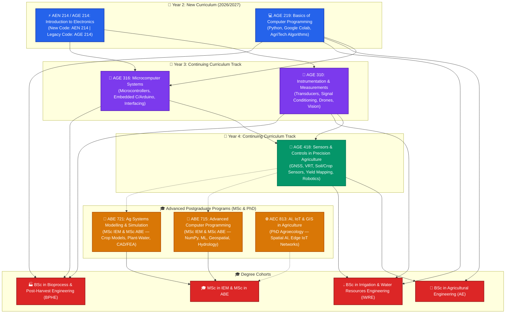
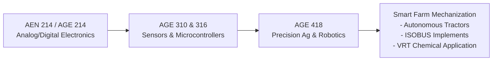
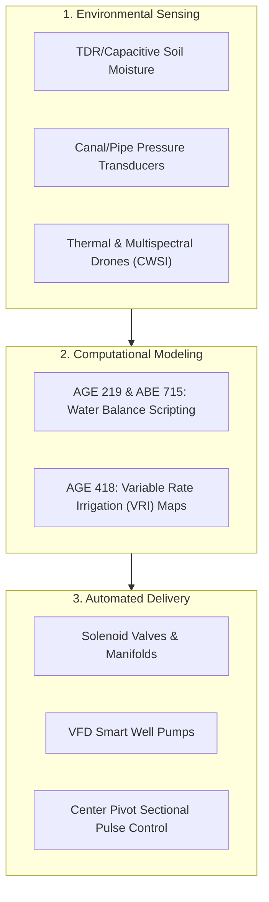
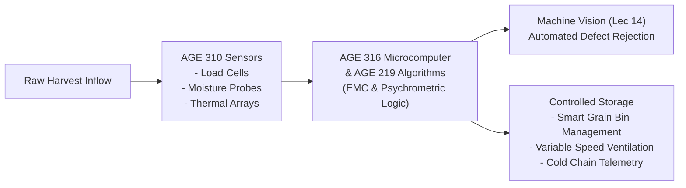

# 🌾 Sokoine University of Agriculture (SUA)
## School of Engineering and Technology (SoET) — Department of Agricultural Engineering
### 📚 Academic Knowledge Base & Course Notes Repository

[](https://www.sua.ac.tz/)
[](https://www.sua.ac.tz/)
[](#-degree-program-curriculum-matrix)
[](#-postgraduate-degree-programs)
[-purple.svg)](#)

A centralized academic repository housing official lecture compendia, presentation slide decks, laboratory tutorials, computational notebooks, continuous assessments, and university examination papers. This curriculum bridges traditional biosystems mechanics with **Agriculture 4.0**, modern **AgriTech**, embedded electronics, smart instrumentation, and precision biosystems engineering.

---

> [!IMPORTANT] Curriculum Transition Policy (Academic Years 2025/2026 & 2026/2027)
> Sokoine University of Agriculture (SUA) launched an updated engineering curriculum starting from academic year **2025/2026**.
> In the current academic year **2026/2027**:
> * **First-Year and Second-Year Students**: Operate under the **new curriculum**, where the introductory electronics course is officially designated as **AEN 214: Introduction to Electronics** (formerly AGE 214).
> * **Third-Year and Fourth-Year Students**: Older continuing student cohorts remain under the **legacy curriculum**, continuing with their established course codes: **AGE 310**, **AGE 316**, and **AGE 418**.
> * **Postgraduate Students**: Courses **ABE 715** and **ABE 721** are advanced graduate courses serving candidates in both **MSc in Irrigation Engineering and Management (MSc IEM)** and **MSc in Agricultural and Biosystems Engineering (MSc ABE)**.

---

## 🏛️ Academic Program Overview

The notes and learning modules in this repository directly support the core undergraduate engineering curricula at Sokoine University of Agriculture, with postgraduate extensions:

1. **BSc in Agricultural Engineering (BSc AE)**: Farm power and machinery, agricultural automation, precision agriculture, robotics, and integrated bio-production engineering.
2. **BSc in Irrigation and Water Resources Engineering (BSc IWRE)**: Hydrological measurement, hydraulic automation, telemetry, soil-water sensor networks, and Variable Rate Irrigation (VRI).
3. **BSc in Bioprocess and Post-Harvest Engineering (BSc BPHE)**: Post-harvest value addition, smart storage, grain drying control, machine vision quality inspection, and food bioprocess instrumentation.
4. **MSc in Irrigation Engineering and Management (MSc IEM)** & **MSc in Agricultural and Biosystems Engineering (MSc ABE)**: Advanced computational modeling, numerical hydrology, system dynamics, CAD/CAM, and finite element analysis (FEA).
5. **PhD in Agroecology / Doctoral Studies**: Advanced synthesis of AI, IoT telemetry, and GIS spatial modeling (AEC 813).

---

## 🗺️ Cross-Disciplinary Architecture & Course Mapping

The diagram below illustrates how core engineering courses progress from foundational electronics and computational scripting into advanced smart agricultural systems across the undergraduate and postgraduate degree programs:



---

## 📊 Degree Program Curriculum Matrix

The table below summarizes how each course module connects to the specific technical competencies required for **BSc AE**, **BSc IWRE**, and **BSc BPHE** students, as well as postgraduate **MSc IEM / MSc ABE** scholars:

| Course Code & Title | Curriculum Status & Year | BSc Agricultural Engineering (BSc AE) | BSc Irrigation & Water Resources Engineering (BSc IWRE) | BSc Bioprocess & Post-Harvest Engineering (BSc BPHE) |
| :--- | :--- | :--- | :--- | :--- |
| [**AEN 214 / AGE 214**](file:///home/kadefue/Course_Notes/AGE%20214)<br>Introduction to Electronics | **New Curriculum (AEN 214)** for Y1/Y2<br>*Legacy (AGE 214)* for Y3/Y4 | **Core Hardware Foundation**: BJT/MOSFET motor drivers, sensor conditioning, power rectifiers for farm machinery. | **Sensing Foundations**: Operational amplifiers, voltage dividers, and signal conditioning for environmental probes. | **Process Controls**: Op-amp comparator circuits, temperature/moisture transducers, and actuator drive circuitry. |
| [**AGE 219**](file:///home/kadefue/Course_Notes/AGE%20219)<br>Basics of Computer Programming | Year 2 | **Farm Computing**: Plow draft force algorithms, fertilizer application math, machinery operational efficiency scripting. | **Hydrological Modeling**: Cumulative rainfall loops, crop water requirements ($ET_c$), and automated irrigation logic. | **Storage Analytics**: Data persistence, file I/O, and capstone mini-project on *"The Smart Grain Bin Manager"*. |
| [**AGE 310**](file:///home/kadefue/Course_Notes/AGE%20310)<br>Instrumentation & Measurements | Year 3 | **Field Sensing & Robotics**: Transducers, load cells, ag drones (UAVs), machine vision, CAN bus, and ag robotics. | **Water Measurement**: Pressure transducers, ultrasonic level sensors, flow meters, dynamic sensor response, and telemetry. | **Quality & Grading**: Machine vision for sorting/grading, load cells for batching, dynamic thermal response in dryers. |
| [**AGE 316**](file:///home/kadefue/Course_Notes/AGE%20316)<br>Microcomputer Systems | Year 3 | **Machine Intelligence**: Embedded microcontrollers, Arduino interfacing, tractor implement ECU prototypes. | **Irrigation Automation**: Automated pump controllers, valve actuation timers, remote sensor telemetry nodes. | **Core Embedded Controls**: Microcontroller architecture, PID temperature/airflow controllers for drying and cold storage. |
| [**AGE 418**](file:///home/kadefue/Course_Notes/AGE%20418)<br>Sensors & Controls in Precision Ag | Year 4 | **Core Specialization**: GNSS/RTK auto-steering, proximal crop/soil sensors, yield monitors, VRT, autonomous field robots. | **Precision Water Management**: Variable Rate Irrigation (VRI), CWSI crop water stress detection, EMI soil mapping. | **Quality & Supply Chain**: Harvest moisture mapping, yield sensor calibration, automated grain sorting and traceability. |
| [**ABE 715**](file:///home/kadefue/Course_Notes/ABE%20715)<br>Advanced Computer Programming | **Postgraduate (MSc)**<br>MSc IEM & MSc ABE | Advanced numerical algorithms, machine learning basics, computer vision, and IoT data processing. | Primary curriculum for **MSc Irrigation Engineering and Management**; geospatial analysis & numerical hydrology. | Advanced process simulation, bio-data analytics, and predictive spoilage modeling. |
| [**ABE 721**](file:///home/kadefue/Course_Notes/ABE%20721)<br>Ag Systems Modelling & Simulation | **Postgraduate (MSc)**<br>MSc IEM & MSc ABE | CAD/CAM, finite element analysis (FEA), system dynamics, and dynamic machinery simulation. | Dynamic plant-water relations, soil-water-atmosphere models, soft computing, and catchment management. | Bioreactor dynamics, thermal process simulation, and CAD for agro-processing facility design. |
| [**AEC 813**](file:///home/kadefue/Course_Notes/AEC%20813)<br>AI, IoT & GIS in Agriculture | **Postgraduate (PhD)**<br>PhD Agroecology | Edge-AI for autonomous tractors, spatial GIS integration, and large-scale agricultural telematics. | Spatial watershed GIS analytics, AI-driven river basin forecasting, and satellite-based irrigation monitoring. | AI-driven spectral classification for food quality, supply chain IoT telemetry, and smart storage automation. |

---

## 🔍 Detailed Notes Breakdown by Degree Program

---

### 1. 🌾 BSc in Agricultural Engineering (BSc AE)

#### 🎯 Educational Focus & Objectives
The BSc in Agricultural Engineering trains students to design, mechanize, and optimize biological production systems. The coursework bridges traditional mechanical principles (engines, transmissions, tillage mechanics, structures) with modern electronics, microcomputers, satellite navigation, and autonomous field robotics.

#### 📚 How the Repository Notes Serve BSc AE Students:
* **[AEN 214 / AGE 214: Introduction to Electronics](file:///home/kadefue/Course_Notes/AGE%20214)**:
  * *Note: First and Second Years follow course code **AEN 214** (2025/2026 new curriculum rollout), while Third/Fourth Years reference **AGE 214**.*
  * Master semiconductor physics, diode rectification circuits, and BJT/MOSFET configurations essential for switching high-current agricultural actuators (solenoids, linear actuators, starter relays).
  * Study operational amplifier (Op-Amp) signal conditioning to interface analog sensors (strain gauges measuring draft forces on implements) with electronic controllers.
  * Understand digital logic primitives and power electronics used in modern tractor electronic control units (ECUs).
* **[AGE 219: Basics of Computer Programming](file:///home/kadefue/Course_Notes/AGE%20219)**:
  * Learn Python 3.x and cloud execution via Google Colab with no local setup hurdles.
  * Solve field engineering problems through code: calculate precise fertilizer application rates (kg/ha), implement tractor plow draft force equations based on soil shear parameters, and model tractor implement interactions.
  * Apply Object-Oriented Programming (OOP) in Lecture 8 to model agricultural machinery as programmatic entities (`Tractor` classes with `fuel_consumption()`, `speed()`, and `implement_load()` methods).
  * Visualize machinery operational datasets with Pandas and Matplotlib to inspect engine speed vs. fuel consumption.
* **[AGE 310: Instrumentation and Measurements](file:///home/kadefue/Course_Notes/AGE%20310)**:
  * Comprehensive compendia covering static and dynamic instrument characteristics (Lectures 1–10).
  * Detailed theory on resistive strain gauges and Wheatstone bridges used in dynamometers and draft force measurement.
  * Dedicated lecture modules on **Agricultural Robotics** (Lecture 12), **Agricultural Drones / UAVs** (Lecture 13), **Machine Vision in Agriculture** (Lecture 14), and **Data Communication Protocols (CAN bus, ISO 11783 / ISOBUS)** (Lecture 9).
* **[AGE 316: Microcomputer Systems](file:///home/kadefue/Course_Notes/AGE%20316)**:
  * Understand CPU registers, memory mapping, interrupt service routines (ISRs), and ADC peripherals.
  * Write embedded C / Arduino sketches to read engine tachometers, implement lift sensors, and actuate hydraulic valves.
  * Access actual university examination papers and tests featuring practical programming questions on agricultural automated controllers.
* **[AGE 418: Sensors and Controls in Precision Agriculture](file:///home/kadefue/Course_Notes/AGE%20418)**:
  * The capstone technical course for modern Agricultural Engineers.
  * Learn GNSS, differential GPS (DGPS), and Real-Time Kinematic (RTK) sub-centimeter positioning for autonomous tractor steering and auto-guidance.
  * Study proximal soil sensors (electromagnetic induction, electrical conductivity $EC_a$), optical crop sensors (GreenSeeker, NDVI), yield monitors with impact plates, and Variable Rate Technology (VRT) controllers for seed and agrochemical placement.
  * Analyze economic and environmental trade-offs (Lecture 14) of precision mechanization.



---

### 2. 💧 BSc in Irrigation and Water Resources Engineering (BSc IWRE)

#### 🎯 Educational Focus & Objectives
The BSc in Irrigation and Water Resources Engineering equips engineers to manage water resources sustainably, design pressurized and surface irrigation infrastructure, manage agricultural drainage, and deploy smart water management technologies in response to climate variability.

#### 📚 How the Repository Notes Serve BSc IWRE Students:
* **[AEN 214 / AGE 214: Introduction to Electronics](file:///home/kadefue/Course_Notes/AGE%20214)**:
  * Understand low-noise operational amplifier conditioning for soil moisture tension sensors and water level probes.
  * Build transistor switching stages for 12V/24V latching solenoid irrigation valves.
* **[AGE 219: Basics of Computer Programming](file:///home/kadefue/Course_Notes/AGE%20219)**:
  * **Lecture 3 Case Study**: Developing an automated smart irrigation decision engine in Python based on real-time soil moisture thresholds.
  * **Lecture 4 Case Study**: Looping through 7-day cumulative rainfall and weather records to evaluate effective precipitation and crop water requirements.
  * **Data Analytics & Plotting (Lecture 9)**: Plotting soil moisture retention curves and cumulative irrigation depth against daily reference evapotranspiration ($ET_o$).
* **[AGE 310: Instrumentation and Measurements](file:///home/kadefue/Course_Notes/AGE%20310)**:
  * Understanding pressure transducers for pipe networks, booster pump monitoring, and drip line pressure regulation.
  * Analysis of capacitive, frequency-domain reflectometry (FDR), and time-domain reflectometry (TDR) soil moisture probes.
  * Ultrasonic, hydrostatic, and optical water level sensors for open canals, weir structures, and storage reservoirs.
  * Actuator technologies (Lecture 7): Solenoid valves, electric motorized ball valves, and variable frequency drive (VFD) pump interfacing.
  * Data telemetry architectures (Lecture 15): LoRaWAN and MQTT wireless sensor networks for transmitting moisture and flow data from remote irrigation fields to central dashboards.
* **[AGE 418: Sensors and Controls in Precision Agriculture](file:///home/kadefue/Course_Notes/AGE%20418)**:
  * **Lecture 12: Precision Irrigation and Water Management**: Detailed compendium on site-specific irrigation, Variable Rate Irrigation (VRI) on center pivots, zone-specific drip automation, and deficit irrigation strategies.
  * **Remote Sensing in Water Management (Lecture 3)**: Utilizing Normalized Difference Water Index (NDWI), thermal infrared canopy thermography, and the Crop Water Stress Index (CWSI) to detect plant water stress before visible wilting occurs.
  * **GIS and Spatial Variability (Lectures 2 & 10)**: Digital elevation models (DEM), watershed delineations, flow accumulation mapping, and geospatial soil water-holding capacity maps using geostatistical kriging.
* **Postgraduate Synergies ([ABE 715](file:///home/kadefue/Course_Notes/ABE%20715) & [ABE 721](file:///home/kadefue/Course_Notes/ABE%20721))**:
  * ABE 715 specifically serves **MSc Irrigation Engineering and Management (MSc IEM)** with Python routines for numerical integration of hydrographs and geospatial raster analysis.
  * ABE 721 explores dynamic soil-water-atmosphere-plant models, Richards' equation simulations for unsaturated flow, and soft computing in water resource management.



---

### 3. 🏭 BSc in Bioprocess and Post-Harvest Engineering (BSc BPHE)

#### 🎯 Educational Focus & Objectives
The BSc in Bioprocess and Post-Harvest Engineering prepares engineers to eliminate post-harvest losses, design agro-processing facilities, optimize grain drying and storage, maintain cold chains, develop functional biomaterials, and implement automated quality control systems.

#### 📚 How the Repository Notes Serve BSc BPHE Students:
* **[AEN 214 / AGE 214: Introduction to Electronics](file:///home/kadefue/Course_Notes/AGE%20214)**:
  * Temperature transducer circuits: Thermocouples, Resistance Temperature Detectors (RTD Pt100), and thermistors paired with precision operational amplifiers.
  * Rectification, power supplies, and solid-state relay (SSR) switching circuits to control electric heating elements in batch dryers and refrigeration compressors.
  * Filter circuits to remove noise from sensitive micro-strain load cells in continuous grain weighing systems.
* **[AGE 219: Basics of Computer Programming](file:///home/kadefue/Course_Notes/AGE%20219)**:
  * **Lecture 10 Capstone Mini-Project**: *"The Smart Grain Bin Manager"* — a full-stack integrated Python system designed to model silo temperature, equilibrium moisture content (EMC), and psychrometric conditions to prevent mould proliferation and grain spoilage.
  * **Lecture 7**: File handling and persistence for historical ambient temperature and humidity data logging in grain silos and cold storage rooms.
* **[AGE 310: Instrumentation and Measurements](file:///home/kadefue/Course_Notes/AGE%20310)**:
  * Dynamic characteristics of thermal systems (Lecture 10): Modeling first-order sensor lag in pasteurizers, dryers, and heat exchangers.
  * **Lecture 14: Machine Vision in Agriculture**: Image processing techniques (color thresholding, edge detection, morphological filtering) for automated optical sorting of produce, sorting grains by size, and defect identification in fresh fruit packing houses.
  * Load cells, piezo-resistive pressure sensors, and relative humidity sensors (capacitive polymer sensors) essential for bioreactor monitoring and modified atmosphere packaging (MAP).
* **[AGE 316: Microcomputer Systems](file:///home/kadefue/Course_Notes/AGE%20316)**:
  * **Core 3rd-Year Requirement**: The examination papers (`UNIVERSITY EXAMINATION PAPER AGE 316`) explicitly test both BSc AE and BSc BPHE students on embedded microcomputer systems.
  * Designing embedded PID controllers on Arduino/microcontroller architectures for precise closed-loop temperature and humidity regulation in food dehydrators.
  * Interfacing stepper and servo motors for automated bioproduct conveyor diverters and sorting arms.
* **[AGE 418: Sensors and Controls in Precision Agriculture](file:///home/kadefue/Course_Notes/AGE%20418)**:
  * On-combine grain moisture sensors, protein content spectrometers, and grain loss impact sensors.
  * Traceability systems, RFID tracking, and supply chain telemetry from the farm gate to the processing plant.



---

## 🗂️ Course Directory & Material Inventory

Below is an exhaustive inventory of the course directories maintained in this repository, complete with quick links to lecture slides, compendia, assignments, and examination papers:

```
Course_Notes/
├── AGE 214/   ⚡ AEN 214 / AGE 214: Introduction to Electronics (New Code: AEN 214)
├── AGE 219/   💻 AGE 219: Basics of Computer Programming (Year 2)
├── AGE 310/   📡 AGE 310: Instrumentation and Measurements (Year 3)
├── AGE 316/   🧠 AGE 316: Microcomputer Systems (Year 3)
├── AGE 418/   🚜 AGE 418: Sensors and Controls in Precision Agriculture (Year 4)
├── ABE 715/   🐍 ABE 715: Advanced Computer Programming (MSc IEM & MSc ABE)
├── ABE 721/   📐 ABE 721: Ag Systems Modelling and Simulation (MSc IEM & MSc ABE)
└── AEC 813/   🌐 AEC 813: AI, IoT, and GIS Application in Agriculture (PhD Agroecology)
```

### Detailed Course Folders:

#### 1. [`AEN 214 / AGE 214: Introduction to Electronics`](file:///home/kadefue/Course_Notes/AGE%20214)
* **Curriculum Note**: Coded as **AEN 214** under the new curriculum (active for 1st & 2nd Years in 2026/2027) and **AGE 214** under the continuing legacy curriculum.
* **Instructor**: Dr. Kadeghe Goodluck Fue (Electronics and Precision Agriculture Lab - EPAL)
* **Complete Compendia (LaTeX Generated PDFs)**:
  * [Lecture 1: Intro to Electronics & Semiconductor Physics](file:///home/kadefue/Course_Notes/AGE%20214/AGE214Lecture1CompendiumFixed.tex.pdf)
  * [Lecture 2: Classification of Materials & Band Theory](file:///home/kadefue/Course_Notes/AGE%20214/AGE214Lecture2Compendium.tex.pdf)
  * [Lecture 3: The PN Junction Diode](file:///home/kadefue/Course_Notes/AGE%20214/AGE214Lecture3Compendium.tex.pdf)
  * [Lecture 4: Diode Characteristics & Equivalent Circuits](file:///home/kadefue/Course_Notes/AGE%20214/AGE214Lecture4CompendiumFixed.tex.pdf)
  * [Lecture 5: Rectifiers (Half-Wave, Full-Wave, Bridge)](file:///home/kadefue/Course_Notes/AGE%20214/AGE214Lecture5CompendiumFixed.tex.pdf)
  * [Lecture 6: Filters and Zener Regulators](file:///home/kadefue/Course_Notes/AGE%20214/AGE214Lecture6Compendium.tex.pdf)
  * [Lecture 7: Diode Clippers and Clampers](file:///home/kadefue/Course_Notes/AGE%20214/AGE214Lecture7Compendium.tex.pdf)
  * [Lecture 8: Bipolar Junction Transistors (BJT)](file:///home/kadefue/Course_Notes/AGE%20214/AGE214Lecture8Compendium.tex.pdf)
  * [Lecture 9: BJT Configurations (CB, CE, CC)](file:///home/kadefue/Course_Notes/AGE%20214/AGE214Lecture9Compendium.tex.pdf)
  * [Lecture 10: BJT DC Biasing & Load Lines](file:///home/kadefue/Course_Notes/AGE%20214/AGE214Lecture10Compendium.tex.pdf)
  * [Lecture 11: Field Effect Transistors (JFET)](file:///home/kadefue/Course_Notes/AGE%20214/AGE214Lecture11Compendium.tex.pdf)
  * [Lecture 12: MOSFET Fundamentals & Switching](file:///home/kadefue/Course_Notes/AGE%20214/AGE214Lecture12Compendium.tex.pdf)
  * [Lecture 13: Operational Amplifiers (Op-Amps) Theory](file:///home/kadefue/Course_Notes/AGE%20214/AGE214Lecture13CompendiumFinal.tex.pdf)
  * [Lecture 14: Basic Op-Amp Circuits & Applications](file:///home/kadefue/Course_Notes/AGE%20214/AGE214Lecture14Compendium.tex.pdf)
  * [Lecture 15: Digital Electronics, Transducers & DAQ](file:///home/kadefue/Course_Notes/AGE%20214/AGE214Lecture15CompendiumFixed.tex.pdf)
* **Presentation Slide Decks**: Lectures 1 to 15 in `.pptx` format.

---

#### 2. [`AGE 219: Basics of Computer Programming`](file:///home/kadefue/Course_Notes/AGE%20219)
* **Instructor**: Dr. Kadeghe Fue | **Toolchain**: Python 3.x, Google Colaboratory
* **Course Syllabus & Contract**: [Official Course Outline & Learning Contract](file:///home/kadefue/Course_Notes/AGE%20219/Course%20Outline.pdf)
* **Lecture Modules & Compendia**:
  * [Compendium 1: Intro to Python, Code Cells & Agriculture 4.0](file:///home/kadefue/Course_Notes/AGE%20219/Lecture%20Compendium%201.pdf)
  * [Compendium 2: Variables, Types & Fertilizer Rate Math](file:///home/kadefue/Course_Notes/AGE%20219/Lecture%20Compendium%202.pdf)
  * [Compendium 3: Control Flow & Smart Irrigation Logic](file:///home/kadefue/Course_Notes/AGE%20219/Lecture%20Compendium%203.pdf)
  * [Compendium 4: Loops & Cumulative Rainfall Analysis](file:///home/kadefue/Course_Notes/AGE%20219/Lecture%20Compendium%204.pdf)
  * [Compendium 5: Functions & Modular Tractor Draft Modeling](file:///home/kadefue/Course_Notes/AGE%20219/Lecture%20Compendium%205.pdf)
  * [Compendium 6: Data Structures for Greenhouse Telemetry](file:///home/kadefue/Course_Notes/AGE%20219/Lecture%20Compendium%206.pdf)
  * [Compendium 7: File I/O & Orchard Frost Event Detection](file:///home/kadefue/Course_Notes/AGE%20219/Lecture%20Compendium%207.pdf)
  * [Compendium 8: Object-Oriented Programming (OOP) in AgriTech](file:///home/kadefue/Course_Notes/AGE%20219/Lecture%20Compendium%208.pdf)
  * [Compendium 9: Data Analytics & Plotting (Pandas/Matplotlib)](file:///home/kadefue/Course_Notes/AGE%20219/Lecture%20Compendium%209.pdf)
  * [Compendium 10: Capstone Project — "The Smart Grain Bin Manager"](file:///home/kadefue/Course_Notes/AGE%20219/Lecture%20Compendium%2010.pdf)
* **Assessments**: Assignments 1 & 2, Continuous Tests (2023–2025).

---

#### 3. [`AGE 310: Instrumentation and Measurements`](file:///home/kadefue/Course_Notes/AGE%20310)
* **Instructor**: Dr. Kadeghe Fue | **Facility**: Electronics & Precision Agriculture Lab (EPAL)
* **Compendia & Lecture Summaries**:
  * [Lecture 1: Intro & Generalized Measurement System](file:///home/kadefue/Course_Notes/AGE%20310/AGE%20310%20Compendium%20-%20Lecture%201.pdf)
  * [Lecture 2: Measurement Standards, Errors & Calibration](file:///home/kadefue/Course_Notes/AGE%20310/AGE%20310%20Compendium%20-%20Lecture%202.pdf)
  * [Lecture 3: Resistive Transducers (Strain Gauges, RTDs, Bridges)](file:///home/kadefue/Course_Notes/AGE%20310/AGE%20310%20Compendium%20-%20Lecture%203.pdf)
  * [Lecture 4: Capacitive and Inductive Transducers (LVDTs)](file:///home/kadefue/Course_Notes/AGE%20310/AGE%20310%20Compendium%20-%20Lecture%204.pdf)
  * [Lecture 5: Piezoelectric & Photoelectric Sensors](file:///home/kadefue/Course_Notes/AGE%20310/AGE%20310%20Compendium%20-%20Lecture%205.pdf)
  * [Lecture 6: Signal Conditioning (Amps, Filters, Bridges)](file:///home/kadefue/Course_Notes/AGE%20310/AGE%20310%20Compendium%20-%20Lecture%206.pdf)
  * [Lecture 7: Actuators and Final Control Elements](file:///home/kadefue/Course_Notes/AGE%20310/AGE%20310%20Compendium%20-%20Lecture%207.pdf)
  * [Lecture 8: Digital Logic & Microcontroller Interfacing](file:///home/kadefue/Course_Notes/AGE%20310/AGE%20310%20Compendium%20-%20Lecture%208.pdf)
  * [Lecture 9: Data Communication Protocols (SPI, I2C, CAN Bus)](file:///home/kadefue/Course_Notes/AGE%20310/AGE%20310%20Compendium%20-%20Lecture%209.pdf)
  * [Lecture 10: Dynamic Characteristics of Instruments](file:///home/kadefue/Course_Notes/AGE%20310/AGE%20310%20Compendium%20-%20Lecture%2010Dynamic%20Characteristics%20of%20Instruments.pdf)
  * [Lecture 11: Introduction to Feedback Control Systems](file:///home/kadefue/Course_Notes/AGE%20310/AGE%20310%20Compendium%20-%20Lecture%2011Introduction%20to%20Control%20Systems.pdf)
  * [Lecture 12: Introduction to Agricultural Robotics](file:///home/kadefue/Course_Notes/AGE%20310/AGE%20310%20Compendium%20-%20Lecture%2012Introduction%20to%20Agricultural%20Robotics.pdf)
  * [Lecture 13: Agricultural Drones & UAVs](file:///home/kadefue/Course_Notes/AGE%20310/AGE%20310%20Compendium%20-%20Lecture%2013Agricultural%20Drones%20UAVs.pdf)
  * [Lecture 14: Machine Vision in Agriculture](file:///home/kadefue/Course_Notes/AGE%20310/AGE%20310%20Compendium%20-%20Lecture%2014Machine%20Vision%20in%20Agriculture.pdf)
  * [Lecture 15: IoT and Smart Farming Integration](file:///home/kadefue/Course_Notes/AGE%20310/AGE%20310%20Compendium%20-%20Lecture%2015IoT%20and%20Smart%20Farming.pdf)
* **University Exams**: University Examination Papers for BSc AE, BSc IWRE, and BSc BPHE cohorts.

---

#### 4. [`AGE 316: Microcomputer Systems`](file:///home/kadefue/Course_Notes/AGE%20316)
* **Instructor**: Dr. Kadeghe Fue | **Target**: BSc AE (Year 3) & BSc BPHE (Year 3)
* **Core Topics**:
  * Microcomputer Architecture: CPU, ALU, registers, memory hierarchy (RAM, ROM, EEPROM, Flash), address/data/control buses.
  * Embedded C & Arduino firmware engineering: `setup()`, `loop()`, port manipulation, hardware timers, and ISRs.
  * Analog-to-Digital Conversion: ADC quantization step, voltage references, multi-channel sampling.
  * Interfacing Sensors & Actuators: Interfacing digital temperature/humidity sensors, optical encoders, relay modules, and motor driver H-bridges.
* **Exams & Past Papers**:
  * [University Examination Paper AGE 316 (2024–2025)](file:///home/kadefue/Course_Notes/AGE%20316/UNIVERSITY%20EXAMINATION%20PAPER%20AGE%20316%202024-2025.docx)
  * [University Examination Paper AGE 316 (2023–2024)](file:///home/kadefue/Course_Notes/AGE%20316/AGE%20316%202023_2024%20UE.docx)
  * Tests 1 & 2 (2023–2025) with practical microcontroller design scenarios.

---

#### 5. [`AGE 418: Sensors and Controls in Precision Agriculture`](file:///home/kadefue/Course_Notes/AGE%20418)
* **Instructor**: Dr. Kadeghe Fue | **Lab**: Electronics and Precision Agriculture Lab (EPAL)
* **Compendia & Lecture Presentations**:
  * [Lecture 1: Introduction to Precision Agriculture](file:///home/kadefue/Course_Notes/AGE%20418/AGE418Lecture1Compendium.tex.pdf)
  * [Lecture 2: GIS and GPS / GNSS Basics](file:///home/kadefue/Course_Notes/AGE%20418/AGE418Lecture2Compendium.tex.pdf)
  * [Lecture 3: Remote Sensing & Spectral Vegetation Indices](file:///home/kadefue/Course_Notes/AGE%20418/AGE418Lecture3Compendium.tex.pdf)
  * [Lectures 4 & 5: Proximal Soil Sensors ($EC_a$, EMI, pH)](file:///home/kadefue/Course_Notes/AGE%20418/AGE418Lecture4Compendium.tex.pdf)
  * [Lecture 6: Proximal Plant and Crop Sensors (Canopy Reflectance)](file:///home/kadefue/Course_Notes/AGE%20418/AGE418Lecture6Compendium.tex.pdf)
  * [Lecture 7: Data Collection and IoT in Precision Ag](file:///home/kadefue/Course_Notes/AGE%20418/AGE418Lecture7Compendium.tex.pdf)
  * [Lecture 8: Control Systems and Variable Rate Technology (VRT)](file:///home/kadefue/Course_Notes/AGE%20418/AGE418Lecture8Compendium.tex.pdf)
  * [Lecture 9: Yield Monitoring and Spatial Mapping](file:///home/kadefue/Course_Notes/AGE%20418/AGE418Lecture9Compendium.tex.pdf)
  * [Lecture 10: Data Management & Geostatistics (Kriging)](file:///home/kadefue/Course_Notes/AGE%20418/AGE418Lecture10Compendium.tex.pdf)
  * [Lecture 11: Decision Support Systems (DSS) & AI in PA](file:///home/kadefue/Course_Notes/AGE%20418/AGE%20418%20-%20Lecture%2011%20-%20DSS%20and%20AI%20in%20Precision%20Agriculture.pptx)
  * [Lecture 12: Precision Irrigation & Water Management](file:///home/kadefue/Course_Notes/AGE%20418/AGE418Lecture12Compendium.tex.pdf)
  * [Lecture 13: Agricultural Robotics and Automation](file:///home/kadefue/Course_Notes/AGE%20418/AGE418Lecture13Compendium.tex.pdf)
  * [Lecture 14: Economic & Environmental Impacts of PA](file:///home/kadefue/Course_Notes/AGE%20418/AGE418Lecture14Compendium.tex.pdf)
  * [Lecture 15: Future Trends & Frontier Challenges](file:///home/kadefue/Course_Notes/AGE%20418/AGE418Lecture15Compendium.tex.pdf)
* **Assessments**: Test 1 & 2 papers and University Final Examination papers.

---

#### 6. [`ABE 715: Advanced Computer Programming`](file:///home/kadefue/Course_Notes/ABE%20715)
* **Target Audience**: Master of Science Students (**MSc in Irrigation Engineering and Management [MSc IEM]** & **MSc in Agricultural and Biosystems Engineering [MSc ABE]**)
* **Syllabus Highlights**: Python programming, NumPy matrix operations, Pandas tabular data pipelines, numerical integration (Trapezoidal, Simpson's rule), root finding (Newton-Raphson, Bisection), OpenCV computer vision for biometrics, IoT data streaming, and geospatial spatial raster analysis.

---

#### 7. [`ABE 721: Agricultural Systems Modelling and Simulation`](file:///home/kadefue/Course_Notes/ABE%20721)
* **Target Audience**: Master of Science Students (**MSc in Irrigation Engineering and Management [MSc IEM]** & **MSc in Agricultural and Biosystems Engineering [MSc ABE]**)
* **Modules & Syllabi**: [Official Course Syllabus & Reading List](file:///home/kadefue/Course_Notes/ABE%20721/ABE%20721%20Syllabus.pdf)
* **Key Content**: System dynamics, dynamic crop models (CERES, DSSAT concepts), plant-water relations, soft computing & fuzzy inference in water resources, Computer Aided Design (CAD), and Finite Element Analysis (FEA) using MATLAB.

---

#### 8. [`AEC 813: AI, IoT, and GIS Application in Agriculture`](file:///home/kadefue/Course_Notes/AEC%20813)
* **Target Audience**: PhD in Agroecology / Doctoral Engineering Candidates
* **Key Content**: 15 lecture compendia in LaTeX formatting covering advanced IoT communication architectures, GIS spatial modeling, deep learning architectures in agriculture, and edge-computing implementations.

---

## 🛠️ Recommended Software Tools & Engineering Environments

To get the most out of these course materials, students are encouraged to use the following software environments:

* **Programming & Computational Modeling**:
  * [Python 3.10+](https://www.python.org/) with Jupyter Notebook or [Google Colab](https://colab.research.google.com/) (standard for AGE 219 and ABE 715).
  * Libraries: `numpy`, `pandas`, `matplotlib`, `scipy`, `scikit-learn`, `geopandas`, `opencv-python`.
* **Embedded Electronics & Hardware Prototyping**:
  * [Arduino IDE](https://www.arduino.cc/en/software) for microcomputer firmware (AGE 316).
  * [Fritzing](https://fritzing.org/) or [Tinkercad Circuits](https://www.tinkercad.com/) for breadboard and schematic modeling (AEN 214 / AGE 316).
* **Geospatial & Precision Agriculture**:
  * [QGIS](https://qgis.org/) for spatial analysis, GNSS yield map generation, and raster processing (AGE 418 / ABE 715 / AEC 813).
* **Technical Documentation**:
  * [Overleaf / LaTeX](https://www.overleaf.com/) for drafting engineering reports and assignments matching departmental publishing standards (standard for ABE 721 / AEN 214 compendia).

---

## 📜 Academic Integrity & Responsible Use of AI

As certified by the Department of Agricultural Engineering, professional integrity is paramount:
1. **Engineering Originality**: Engineering decisions impact public safety, crop yields, and rural livelihoods. All submitted calculations, source code, and design schematics must represent the student's individual intellectual work.
2. **Responsible AI Usage**: Generative AI tools (ChatGPT, Gemini, GitHub Copilot) may be utilized as computational tutors for debugging syntax or elucidating mathematical derivations. Submitting raw unverified AI-generated code or prose for graded assignments is strictly prohibited.
3. **Verification Mandate**: Engineers bear professional liability. Any algorithm or equation suggested by an AI must be mathematically verified against physical laws and engineering design standards before deployment in field hardware or safety-critical machinery.

---

## 👨‍🏫 Course Administration & Instructor Information

* **Lead Instructor**: Dr. Kadeghe Goodluck Fue, PhD, P.Eng (T)
* **Department**: Department of Agricultural Engineering (DAE)
* **Faculty**: School of Engineering and Technology (SoET)
* **Institution**: Sokoine University of Agriculture (SUA), Morogoro, Tanzania
* **Laboratory**: Electronics and Precision Agriculture Lab (EPAL)
* **Official Academic Correspondence**: `kadeghe.fue@sua.ac.tz`