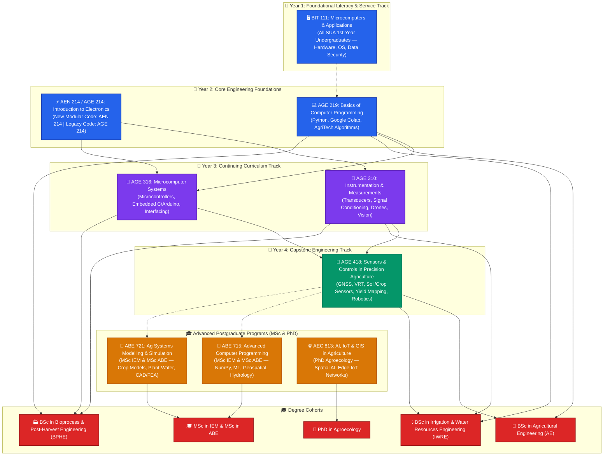
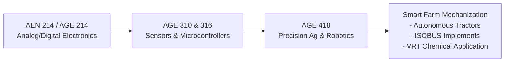
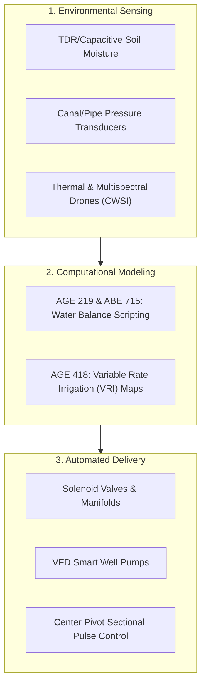
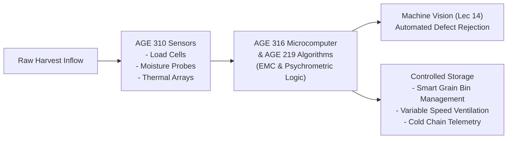

# 🌾 Sokoine University of Agriculture (SUA)
## School of Engineering and Technology (SoET) — Department of Agricultural Engineering
### 📚 Academic Knowledge Base & Course Notes Repository

[](https://www.sua.ac.tz/)
[](https://www.sua.ac.tz/)
[](#-degree-program-curriculum-matrix)
[](#-degree-program-curriculum-matrix)
[-purple.svg)](#)

A centralized academic repository housing official lecture compendia, presentation slide decks, laboratory tutorials, computational notebooks, continuous assessments, and university examination papers. This curriculum bridges traditional biosystems mechanics with **Agriculture 4.0**, modern **AgriTech**, embedded electronics, smart instrumentation, and precision biosystems engineering.

---

> [!IMPORTANT] Curriculum Transition Policy (Academic Years 2025/2026 & 2026/2027)
> Sokoine University of Agriculture (SUA) launched an updated engineering curriculum starting from academic year **2025/2026**.
> In the current academic year **2026/2027**:
> * **First-Year and Second-Year Students**: Operate under the **new curriculum**, where the introductory electronics course is officially organized in the modular directory [AEN 214: Introduction to Electronics](file:///Users/kadefue/Course%20Notes/AEN%20214/README.md) (formerly AGE 214).
> * **Third-Year and Fourth-Year Students**: Older continuing student cohorts remain under the **legacy curriculum**, referencing their established course codes: [AGE 214](file:///Users/kadefue/Course%20Notes/AGE%20214/README.md), [AGE 310](file:///Users/kadefue/Course%20Notes/AGE%20310/README.md), [AGE 316](file:///Users/kadefue/Course%20Notes/AGE%20316/README.md), and [AGE 418](file:///Users/kadefue/Course%20Notes/AGE%20418/README.md).
> * **University Service Courses**: [BIT 111: Microcomputers and Applications](file:///Users/kadefue/Course%20Notes/BIT%20111/README.md) provides fundamental digital literacy and microcomputer principles for undergraduate students across all SUA faculties.
> * **Postgraduate Students**: Courses [ABE 715](file:///Users/kadefue/Course%20Notes/ABE%20715/README.md) and [ABE 721](file:///Users/kadefue/Course%20Notes/ABE%20721/README.md) serve advanced master's candidates in both **MSc in Irrigation Engineering and Management (MSc IEM)** and **MSc in Agricultural and Biosystems Engineering (MSc ABE)**, while [AEC 813](file:///Users/kadefue/Course%20Notes/AEC%20813/README.md) serves doctoral candidates in **PhD in Agroecology**.

---

## 🏛️ Academic Program Overview

The notes and learning modules in this repository directly support the core undergraduate engineering curricula at Sokoine University of Agriculture, university-wide digital literacy, and postgraduate research:

1. **BSc in Agricultural Engineering (BSc AE)**: Farm power and machinery, agricultural automation, precision agriculture, robotics, and integrated bio-production engineering.
2. **BSc in Irrigation and Water Resources Engineering (BSc IWRE)**: Hydrological measurement, hydraulic automation, telemetry, soil-water sensor networks, and Variable Rate Irrigation (VRI).
3. **BSc in Bioprocess and Post-Harvest Engineering (BSc BPHE)**: Post-harvest value addition, smart storage, grain drying control, machine vision quality inspection, and food bioprocess instrumentation.
4. **University-Wide Undergraduate Service**: Digital literacy, operating systems, hardware architectures, microcomputer applications, and data defense across all SUA undergraduate degree programs ([BIT 111](file:///Users/kadefue/Course%20Notes/BIT%20111/README.md)).
5. **MSc in Irrigation Engineering and Management (MSc IEM)** & **MSc in Agricultural and Biosystems Engineering (MSc ABE)**: Advanced computational modeling, numerical hydrology, system dynamics, CAD/CAM, and finite element analysis (FEA) ([ABE 715](file:///Users/kadefue/Course%20Notes/ABE%20715/README.md) & [ABE 721](file:///Users/kadefue/Course%20Notes/ABE%20721/README.md)).
6. **PhD in Agroecology / Doctoral Studies**: Advanced synthesis of Artificial Intelligence, Internet of Things (IoT) telemetry, and GIS spatial modeling ([AEC 813](file:///Users/kadefue/Course%20Notes/AEC%20813/README.md)).

---

## 🗺️ Cross-Disciplinary Architecture & Course Mapping

The diagram below illustrates how core engineering courses progress from foundational electronics and computational scripting into advanced smart agricultural systems across the undergraduate and postgraduate degree programs:



---

## 📊 Degree Program Curriculum Matrix

The table below summarizes how each course module connects to the specific technical competencies required for **BSc AE**, **BSc IWRE**, and **BSc BPHE** students, university-wide service cohorts, and postgraduate **MSc IEM / MSc ABE / PhD** scholars:

| Course Code & Title | Curriculum Status & Year | BSc Agricultural Engineering (BSc AE) | BSc Irrigation & Water Resources Engineering (BSc IWRE) | BSc Bioprocess & Post-Harvest Engineering (BSc BPHE) |
| :--- | :--- | :--- | :--- | :--- |
| [BIT 111](file:///Users/kadefue/Course%20Notes/BIT%20111/README.md)<br>Microcomputers and Applications | Year 1 (University Service Course) | **Digital Foundations**: Hardware architectures, PC diagnostics, and operating system management. | **Data Literacy**: Spreadsheets for hydrological data logging, virus defense, and cloud computing. | **Bioprocess Records**: Laboratory inventory spreadsheets, secure data storage, and digital documentation. |
| [AEN 214](file:///Users/kadefue/Course%20Notes/AEN%20214/README.md)<br>Introduction to Electronics | **New Curriculum (Year 2)**<br>(Active 2025/2026 & 2026/2027) | **Core Hardware Foundation**: Discrete components, BJT/MOSFET drivers, power rectification, and digital logic for agricultural automation. | **Sensing Foundations**: Operational amplifiers, bridge circuits, and low-noise analog signal conditioning for water quality probes. | **Process Controls**: Op-amp comparators, temperature/moisture transducers, and relay switching circuitry for food dehydration. |
| [AGE 214](file:///Users/kadefue/Course%20Notes/AGE%20214/README.md)<br>Introduction to Electronics | **Legacy Curriculum Archive**<br>(Continuing Year 3 & 4 Cohorts) | **Legacy Hardware Reference**: Complete 15-lecture analog/digital sequence, BJT biasing, and power electronics. | **Signal Conditioning Reference**: Diode circuits, filters, Zener regulators, and transducer conditioning compendia. | **Power & Switching**: Transistor switching circuits and op-amp instrumentation amplifiers for bioprocessing systems. |
| [AGE 219](file:///Users/kadefue/Course%20Notes/AGE%20219/README.md)<br>Basics of Computer Programming | Year 2 | **Farm Computing**: Plow draft force algorithms, fertilizer application math, machinery operational efficiency scripting. | **Hydrological Modeling**: Cumulative rainfall loops, crop water requirements ($ET_c$), and automated irrigation logic. | **Storage Analytics**: Data persistence, file I/O, and capstone mini-project on *"The Smart Grain Bin Manager"*. |
| [AGE 310](file:///Users/kadefue/Course%20Notes/AGE%20310/README.md)<br>Instrumentation & Measurements | Year 3 | **Field Sensing & Robotics**: Transducers, load cells, ag drones (UAVs), machine vision, CAN bus, and ag robotics. | **Water Measurement**: Pressure transducers, ultrasonic level sensors, flow meters, dynamic sensor response, and telemetry. | **Quality & Grading**: Machine vision for sorting/grading, load cells for batching, dynamic thermal response in dryers. |
| [AGE 316](file:///Users/kadefue/Course%20Notes/AGE%20316/README.md)<br>Microcomputer Systems | Year 3 | **Machine Intelligence**: Embedded microcontrollers, Arduino interfacing, tractor implement ECU prototypes. | **Irrigation Automation**: Automated pump controllers, valve actuation timers, remote sensor telemetry nodes. | **Core Embedded Controls**: Microcontroller architecture, PID temperature/airflow controllers for drying and cold storage. |
| [AGE 418](file:///Users/kadefue/Course%20Notes/AGE%20418/README.md)<br>Sensors & Controls in Precision Ag | Year 4 | **Core Specialization**: GNSS/RTK auto-steering, proximal crop/soil sensors, yield monitors, VRT, autonomous field robots. | **Precision Water Management**: Variable Rate Irrigation (VRI), CWSI crop water stress detection, EMI soil mapping. | **Quality & Supply Chain**: Harvest moisture mapping, yield sensor calibration, automated grain sorting and traceability. |
| [ABE 715](file:///Users/kadefue/Course%20Notes/ABE%20715/README.md)<br>Advanced Computer Programming | **Postgraduate (MSc)**<br>MSc IEM & MSc ABE | Advanced numerical algorithms, machine learning basics, computer vision, and IoT data processing. | Primary curriculum for **MSc Irrigation Engineering and Management**; geospatial analysis & numerical hydrology. | Advanced process simulation, bio-data analytics, and predictive spoilage modeling. |
| [ABE 721](file:///Users/kadefue/Course%20Notes/ABE%20721/README.md)<br>Ag Systems Modelling & Simulation | **Postgraduate (MSc)**<br>MSc IEM & MSc ABE | CAD/CAM, finite element analysis (FEA), system dynamics, and dynamic machinery simulation. | Dynamic plant-water relations, soil-water-atmosphere models, soft computing, and catchment management. | Bioreactor dynamics, thermal process simulation, and CAD for agro-processing facility design. |
| [AEC 813](file:///Users/kadefue/Course%20Notes/AEC%20813/README.md)<br>AI, IoT & GIS in Agriculture | **Postgraduate (PhD)**<br>PhD Agroecology | Edge-AI for autonomous tractors, spatial GIS integration, and large-scale agricultural telematics. | Spatial watershed GIS analytics, AI-driven river basin forecasting, and satellite-based irrigation monitoring. | AI-driven spectral classification for food quality, supply chain IoT telemetry, and smart storage automation. |

---

## 🔍 Detailed Notes Breakdown by Degree Program

---

### 1. 🌾 BSc in Agricultural Engineering (BSc AE)

#### 🎯 Educational Focus & Objectives
The BSc in Agricultural Engineering trains students to design, mechanize, and optimize biological production systems. The coursework bridges traditional mechanical principles (engines, transmissions, tillage mechanics, structures) with modern electronics, microcomputers, satellite navigation, and autonomous field robotics.

#### 📚 How the Repository Notes Serve BSc AE Students:
* **[AEN 214](file:///Users/kadefue/Course%20Notes/AEN%20214/README.md) / [AGE 214: Introduction to Electronics](file:///Users/kadefue/Course%20Notes/AGE%20214/README.md)**:
  * *Note: First and Second Years follow course code **AEN 214** (new curriculum rollout), while Third/Fourth Years reference **AGE 214**.*
  * Master semiconductor physics, diode rectification circuits, and BJT/MOSFET configurations essential for switching high-current agricultural actuators (solenoids, linear actuators, starter relays).
  * Study operational amplifier (Op-Amp) signal conditioning to interface analog sensors (strain gauges measuring draft forces on implements) with electronic controllers.
  * Understand digital logic primitives and power electronics used in modern tractor electronic control units (ECUs).
* **[AGE 219: Basics of Computer Programming](file:///Users/kadefue/Course%20Notes/AGE%20219/README.md)**:
  * Learn Python 3.x and cloud execution via Google Colab with no local setup hurdles.
  * Solve field engineering problems through code: calculate precise fertilizer application rates (kg/ha), implement tractor plow draft force equations based on soil shear parameters, and model tractor implement interactions.
  * Apply Object-Oriented Programming (OOP) to model agricultural machinery as programmatic entities (`Tractor` classes with `fuel_consumption()`, `speed()`, and `implement_load()` methods).
  * Visualize machinery operational datasets with Pandas and Matplotlib to inspect engine speed vs. fuel consumption.
* **[AGE 310: Instrumentation and Measurements](file:///Users/kadefue/Course%20Notes/AGE%20310/README.md)**:
  * Comprehensive compendia covering static and dynamic instrument characteristics (Lectures 1–10).
  * Detailed theory on resistive strain gauges and Wheatstone bridges used in dynamometers and draft force measurement.
  * Dedicated lecture modules on **Agricultural Robotics** (Lecture 12), **Agricultural Drones / UAVs** (Lecture 13), **Machine Vision in Agriculture** (Lecture 14), and **Data Communication Protocols (CAN bus, ISO 11783 / ISOBUS)** (Lecture 9).
* **[AGE 316: Microcomputer Systems](file:///Users/kadefue/Course%20Notes/AGE%20316/README.md)**:
  * Understand CPU registers, memory mapping, interrupt service routines (ISRs), and ADC peripherals.
  * Write embedded C / Arduino sketches to read engine tachometers, implement lift sensors, and actuate hydraulic valves.
  * Access actual university examination papers and tests featuring practical programming questions on agricultural automated controllers.
* **[AGE 418: Sensors and Controls in Precision Agriculture](file:///Users/kadefue/Course%20Notes/AGE%20418/README.md)**:
  * The capstone technical course for modern Agricultural Engineers.
  * Learn GNSS, differential GPS (DGPS), and Real-Time Kinematic (RTK) sub-centimeter positioning for autonomous tractor steering and auto-guidance.
  * Study proximal soil sensors (electromagnetic induction, electrical conductivity $EC_a$), optical crop sensors (GreenSeeker, NDVI), yield monitors with impact plates, and Variable Rate Technology (VRT) controllers for seed and agrochemical placement.
  * Analyze economic and environmental trade-offs of precision mechanization.



---

### 2. 💧 BSc in Irrigation and Water Resources Engineering (BSc IWRE)

#### 🎯 Educational Focus & Objectives
The BSc in Irrigation and Water Resources Engineering equips engineers to manage water resources sustainably, design pressurized and surface irrigation infrastructure, manage agricultural drainage, and deploy smart water management technologies in response to climate variability.

#### 📚 How the Repository Notes Serve BSc IWRE Students:
* **[AEN 214](file:///Users/kadefue/Course%20Notes/AEN%20214/README.md) / [AGE 214: Introduction to Electronics](file:///Users/kadefue/Course%20Notes/AGE%20214/README.md)**:
  * Understand low-noise operational amplifier conditioning for soil moisture tension sensors and water level probes.
  * Build transistor switching stages for 12V/24V latching solenoid irrigation valves.
* **[AGE 219: Basics of Computer Programming](file:///Users/kadefue/Course%20Notes/AGE%20219/README.md)**:
  * Developing automated smart irrigation decision engines in Python based on real-time soil moisture thresholds.
  * Looping through 7-day cumulative rainfall and weather records to evaluate effective precipitation and crop water requirements.
  * Plotting soil moisture retention curves and cumulative irrigation depth against daily reference evapotranspiration ($ET_o$).
* **[AGE 310: Instrumentation and Measurements](file:///Users/kadefue/Course%20Notes/AGE%20310/README.md)**:
  * Understanding pressure transducers for pipe networks, booster pump monitoring, and drip line pressure regulation.
  * Analysis of capacitive, frequency-domain reflectometry (FDR), and time-domain reflectometry (TDR) soil moisture probes.
  * Ultrasonic, hydrostatic, and optical water level sensors for open canals, weir structures, and storage reservoirs.
  * Actuator technologies: Solenoid valves, electric motorized ball valves, and variable frequency drive (VFD) pump interfacing.
  * Data telemetry architectures: LoRaWAN and MQTT wireless sensor networks for transmitting moisture and flow data from remote irrigation fields to central dashboards.
* **[AGE 418: Sensors and Controls in Precision Agriculture](file:///Users/kadefue/Course%20Notes/AGE%20418/README.md)**:
  * Precision Irrigation and Water Management: Site-specific irrigation, Variable Rate Irrigation (VRI) on center pivots, zone-specific drip automation, and deficit irrigation strategies.
  * Remote Sensing in Water Management: Utilizing Normalized Difference Water Index (NDWI), thermal infrared canopy thermography, and Crop Water Stress Index (CWSI) to detect plant water stress before visible wilting occurs.
  * GIS and Spatial Variability: Digital elevation models (DEM), watershed delineations, flow accumulation mapping, and geospatial soil water-holding capacity maps using geostatistical kriging.
* **Postgraduate Synergies ([ABE 715](file:///Users/kadefue/Course%20Notes/ABE%20715/README.md) & [ABE 721](file:///Users/kadefue/Course%20Notes/ABE%20721/README.md))**:
  * ABE 715 specifically serves **MSc Irrigation Engineering and Management (MSc IEM)** with Python routines for numerical integration of hydrographs and geospatial raster analysis.
  * ABE 721 explores dynamic soil-water-atmosphere-plant models, Richards' equation simulations for unsaturated flow, and soft computing in water resource management.



---

### 3. 🏭 BSc in Bioprocess and Post-Harvest Engineering (BSc BPHE)

#### 🎯 Educational Focus & Objectives
The BSc in Bioprocess and Post-Harvest Engineering prepares engineers to eliminate post-harvest losses, design agro-processing facilities, optimize grain drying and storage, maintain cold chains, develop functional biomaterials, and implement automated quality control systems.

#### 📚 How the Repository Notes Serve BSc BPHE Students:
* **[AEN 214](file:///Users/kadefue/Course%20Notes/AEN%20214/README.md) / [AGE 214: Introduction to Electronics](file:///Users/kadefue/Course%20Notes/AGE%20214/README.md)**:
  * Temperature transducer circuits: Thermocouples, Resistance Temperature Detectors (RTD Pt100), and thermistors paired with precision operational amplifiers.
  * Rectification, power supplies, and solid-state relay (SSR) switching circuits to control electric heating elements in batch dryers and refrigeration compressors.
  * Filter circuits to remove noise from sensitive micro-strain load cells in continuous grain weighing systems.
* **[AGE 219: Basics of Computer Programming](file:///Users/kadefue/Course%20Notes/AGE%20219/README.md)**:
  * Capstone Mini-Project: *"The Smart Grain Bin Manager"* — a full-stack integrated Python system designed to model silo temperature, equilibrium moisture content (EMC), and psychrometric conditions to prevent mould proliferation and grain spoilage.
  * File handling and persistence for historical ambient temperature and humidity data logging in grain silos and cold storage rooms.
* **[AGE 310: Instrumentation and Measurements](file:///Users/kadefue/Course%20Notes/AGE%20310/README.md)**:
  * Dynamic characteristics of thermal systems: Modeling first-order sensor lag in pasteurizers, dryers, and heat exchangers.
  * Machine Vision in Agriculture: Image processing techniques (color thresholding, edge detection, morphological filtering) for automated optical sorting of produce, sorting grains by size, and defect identification in fresh fruit packing houses.
  * Load cells, piezo-resistive pressure sensors, and relative humidity sensors (capacitive polymer sensors) essential for bioreactor monitoring and modified atmosphere packaging (MAP).
* **[AGE 316: Microcomputer Systems](file:///Users/kadefue/Course%20Notes/AGE%20316/README.md)**:
  * Core 3rd-Year Requirement: The examination papers explicitly test both BSc AE and BSc BPHE students on embedded microcomputer systems.
  * Designing embedded PID controllers on Arduino/microcontroller architectures for precise closed-loop temperature and humidity regulation in food dehydrators.
  * Interfacing stepper and servo motors for automated bioproduct conveyor diverters and sorting arms.
* **[AGE 418: Sensors and Controls in Precision Agriculture](file:///Users/kadefue/Course%20Notes/AGE%20418/README.md)**:
  * On-combine grain moisture sensors, protein content spectrometers, and grain loss impact sensors.
  * Traceability systems, RFID tracking, and supply chain telemetry from the farm gate to the processing plant.



---

## 🗂️ Course Directory & Material Inventory

Below is an exhaustive inventory of the 10 course directories maintained in this repository, structured into undergraduate core engineering, university service courses, legacy archives, and advanced postgraduate programs:

```tree
Course_Notes/
├── BIT 111/   🖥️ BIT 111: Microcomputers and Applications (Year 1 Undergraduate University Service Course)
├── AEN 214/   ⚡ AEN 214: Introduction to Electronics (New Curriculum Modular Structure — Year 2)
├── AGE 214/   ⚡ AGE 214: Introduction to Electronics (Legacy Curriculum Archive — Continuing Cohorts)
├── AGE 219/   💻 AGE 219: Basics of Computer Programming (Year 2 Core Engineering)
├── AGE 310/   📡 AGE 310: Instrumentation and Measurements (Year 3 Core Engineering)
├── AGE 316/   🧠 AGE 316: Microcomputer Systems (Year 3 Core Engineering)
├── AGE 418/   🚜 AGE 418: Sensors and Controls in Precision Agriculture (Year 4 Senior Capstone)
├── ABE 715/   🐍 ABE 715: Advanced Computer Programming (Postgraduate MSc IEM & MSc ABE)
├── ABE 721/   📐 ABE 721: Agricultural Systems Modelling and Simulation (Postgraduate MSc IEM & MSc ABE)
└── AEC 813/   🌐 AEC 813: AI, IoT, and GIS Application in Agriculture (Doctoral PhD in Agroecology)
```

---

### Detailed Course Folders & Actual File Inventories

---

#### 1. [BIT 111: Microcomputers and Applications](file:///Users/kadefue/Course%20Notes/BIT%20111/README.md)
* **Department**: Department of Informatics and Information Technology (DIIT), School of Engineering and Technology (SoET) / CoNAS
* **Instructor**: **Madam Bertha Msuliche Lebalwa (MSc)**
* **Target Audience**: First-Year Undergraduate Students across all SUA degree programs (Agricultural Engineering, Agronomy, Animal Science, Veterinary Medicine, Food Science, Forestry, Aquaculture, etc.).
* **Course Documentation**:
  * [BIT 111 Course Description (PDF)](file:///Users/kadefue/Course%20Notes/BIT%20111/BIT%20111%20Course%20Description.pdf)
  * [BIT 111 Course Outline (PDF)](file:///Users/kadefue/Course%20Notes/BIT%20111/Notes/BIT_111_Course_Outline.pdf)
  * [BIT 111 Comprehensive README](file:///Users/kadefue/Course%20Notes/BIT%20111/README.md)
* **Modular Subdirectories**:
  * **`Notes/` (Comprehensive Compendia — ReportLab PDFs with 40 Q&A & Model Answers)**:
    * [Topic 1: Introduction to Microcomputers (65 Pages)](file:///Users/kadefue/Course%20Notes/BIT%20111/Notes/BIT_111_Topic_1_Compendium.pdf)
    * [Topic 2: Main Components of a Microcomputer (40 Pages)](file:///Users/kadefue/Course%20Notes/BIT%20111/Notes/BIT_111_Topic_2_Compendium.pdf)
    * [Topic 3: PC Security Controls (41 Pages)](file:///Users/kadefue/Course%20Notes/BIT%20111/Notes/BIT_111_Topic_3_Compendium.pdf)
    * [Topic 4: Functions & Types of Operating Systems (43 Pages)](file:///Users/kadefue/Course%20Notes/BIT%20111/Notes/BIT_111_Topic_4_Compendium.pdf)
    * [Topic 5: Microcomputer Applications & Spreadsheets (41 Pages)](file:///Users/kadefue/Course%20Notes/BIT%20111/Notes/BIT_111_Topic_5_Compendium.pdf)
    * [Topic 6: Data Security and Malware Defense (42 Pages)](file:///Users/kadefue/Course%20Notes/BIT%20111/Notes/BIT_111_Topic_6_Compendium.pdf)
  * **`Lectures/` (Slide Decks in PPTX & PDF)**:
    * Topic 1: [PPTX](file:///Users/kadefue/Course%20Notes/BIT%20111/Lectures/BIT_111_Topic_1.pptx) | [PDF](file:///Users/kadefue/Course%20Notes/BIT%20111/Lectures/BIT_111_Topic_1.pdf)
    * Topic 2: [PPTX](file:///Users/kadefue/Course%20Notes/BIT%20111/Lectures/BIT_111_Topic_2.pptx) | [PDF](file:///Users/kadefue/Course%20Notes/BIT%20111/Lectures/BIT_111_Topic_2.pdf)
    * Topic 3: [PPTX](file:///Users/kadefue/Course%20Notes/BIT%20111/Lectures/BIT_111_Topic_3.pptx) | [PDF](file:///Users/kadefue/Course%20Notes/BIT%20111/Lectures/BIT_111_Topic_3.pdf)
    * Topic 4: [PPTX](file:///Users/kadefue/Course%20Notes/BIT%20111/Lectures/BIT_111_Topic_4.pptx) | [PDF](file:///Users/kadefue/Course%20Notes/BIT%20111/Lectures/BIT_111_Topic_4.pdf)
    * Topic 5: [PPTX](file:///Users/kadefue/Course%20Notes/BIT%20111/Lectures/BIT_111_Topic_5.pptx) | [PDF](file:///Users/kadefue/Course%20Notes/BIT%20111/Lectures/BIT_111_Topic_5.pdf)
    * Topic 6: [PPTX](file:///Users/kadefue/Course%20Notes/BIT%20111/Lectures/BIT_111_Topic_6.pptx) | [PDF](file:///Users/kadefue/Course%20Notes/BIT%20111/Lectures/BIT_111_Topic_6.pdf)
  * **`Assignment/` (Take-Home Homework Assignments — 100 Marks Each)**:
    * [Assignment 1: Generations & Computer Classification](file:///Users/kadefue/Course%20Notes/BIT%20111/Assignment/BIT_111_Assignment_1.pdf)
    * [Assignment 2: CPU, Memory, Storage & I/O Components](file:///Users/kadefue/Course%20Notes/BIT%20111/Assignment/BIT_111_Assignment_2.pdf)
    * [Assignment 3: PC Security Controls & Environmental Protection](file:///Users/kadefue/Course%20Notes/BIT%20111/Assignment/BIT_111_Assignment_3.pdf)
    * [Assignment 4: Operating System Functions & Process Scheduling](file:///Users/kadefue/Course%20Notes/BIT%20111/Assignment/BIT_111_Assignment_4.pdf)
    * [Assignment 5: Word Processing, Spreadsheets & Financial Math](file:///Users/kadefue/Course%20Notes/BIT%20111/Assignment/BIT_111_Assignment_5.pdf)
    * [Assignment 6: Data Defense, Malware Taxonomy & Backup Rules](file:///Users/kadefue/Course%20Notes/BIT%20111/Assignment/BIT_111_Assignment_6.pdf)
  * **`Figures/`**: Contains architectural diagrams, Von Neumann layouts, and hardware schematics.
  * **`Scripts/`**: Python build pipelines ([build_compendia.py](file:///Users/kadefue/Course%20Notes/BIT%20111/Scripts/build_compendia.py), [build_slides.py](file:///Users/kadefue/Course%20Notes/BIT%20111/Scripts/build_slides.py), [build_assignments.py](file:///Users/kadefue/Course%20Notes/BIT%20111/Scripts/build_assignments.py)).

---

#### 2. [AEN 214: Introduction to Electronics (New Curriculum — 2025/2026 & 2026/2027)](file:///Users/kadefue/Course%20Notes/AEN%20214/README.md)
* **Curriculum Note**: Dedicated modular package representing the **new curriculum** for first and second-year undergraduate engineering students.
* **Instructor**: **Dr. Kadeghe Goodluck Fue (PhD, P.Eng)** | **Lab**: Electronics & Precision Agriculture Lab (EPAL)
* **Modular Subdirectories**:
  * **`Notes/` (Comprehensive Lecture Compendia & Syllabus)**:
    * [AEN 214 Official Course Outline & Syllabus (PDF)](file:///Users/kadefue/Course%20Notes/AEN%20214/Notes/AEN_214_Course_Outline.pdf)
    * [Lecture 1: Passive Electronic Components & Transients](file:///Users/kadefue/Course%20Notes/AEN%20214/Notes/AEN_214_Lecture_1_Compendium.pdf)
    * [Lecture 2: Semiconductor Physics & Band Theory](file:///Users/kadefue/Course%20Notes/AEN%20214/Notes/AEN_214_Lecture_2_Compendium.pdf)
    * [Lecture 3: Semiconductor Diode & Power Rectification](file:///Users/kadefue/Course%20Notes/AEN%20214/Notes/AEN_214_Lecture_3_Compendium.pdf)
    * [Lecture 4: Special Purpose Diodes (Zener, Schottky, Opto)](file:///Users/kadefue/Course%20Notes/AEN%20214/Notes/AEN_214_Lecture_4_Compendium.pdf)
    * [Lecture 5: Bipolar Junction Transistor (BJT) Characteristics & Biasing](file:///Users/kadefue/Course%20Notes/AEN%20214/Notes/AEN_214_Lecture_5_Compendium.pdf)
    * [Lecture 6: Field Effect Transistors (JFET & Power MOSFET)](file:///Users/kadefue/Course%20Notes/AEN%20214/Notes/AEN_214_Lecture_6_Compendium.pdf)
    * [Lecture 7: Number Systems & Digital Arithmetic](file:///Users/kadefue/Course%20Notes/AEN%20214/Notes/AEN_214_Lecture_7_Compendium.pdf)
    * [Lecture 8: Introduction to Digital Electronics & Logic Gates](file:///Users/kadefue/Course%20Notes/AEN%20214/Notes/AEN_214_Lecture_8_Compendium.pdf)
    * [Lecture 9: Boolean Algebra & Karnaugh Map Minimization](file:///Users/kadefue/Course%20Notes/AEN%20214/Notes/AEN_214_Lecture_9_Compendium.pdf)
  * **`Lectures/` (Presentation Slide Decks in PPTX & PDF)**:
    * Lecture 1: [PPTX](file:///Users/kadefue/Course%20Notes/AEN%20214/Lectures/AEN_214_Lecture_1.pptx) | [PDF](file:///Users/kadefue/Course%20Notes/AEN%20214/Lectures/AEN_214_Lecture_1.pdf)
    * Lecture 2: [PPTX](file:///Users/kadefue/Course%20Notes/AEN%20214/Lectures/AEN_214_Lecture_2.pptx) | [PDF](file:///Users/kadefue/Course%20Notes/AEN%20214/Lectures/AEN_214_Lecture_2.pdf)
    * Lecture 3: [PPTX](file:///Users/kadefue/Course%20Notes/AEN%20214/Lectures/AEN_214_Lecture_3.pptx) | [PDF](file:///Users/kadefue/Course%20Notes/AEN%20214/Lectures/AEN_214_Lecture_3.pdf)
    * Lecture 4: [PPTX](file:///Users/kadefue/Course%20Notes/AEN%20214/Lectures/AEN_214_Lecture_4.pptx) | [PDF](file:///Users/kadefue/Course%20Notes/AEN%20214/Lectures/AEN_214_Lecture_4.pdf)
    * Lecture 5: [PPTX](file:///Users/kadefue/Course%20Notes/AEN%20214/Lectures/AEN_214_Lecture_5.pptx) | [PDF](file:///Users/kadefue/Course%20Notes/AEN%20214/Lectures/AEN_214_Lecture_5.pdf)
    * Lecture 6: [PPTX](file:///Users/kadefue/Course%20Notes/AEN%20214/Lectures/AEN_214_Lecture_6.pptx) | [PDF](file:///Users/kadefue/Course%20Notes/AEN%20214/Lectures/AEN_214_Lecture_6.pdf)
    * Lecture 7: [PPTX](file:///Users/kadefue/Course%20Notes/AEN%20214/Lectures/AEN_214_Lecture_7.pptx) | [PDF](file:///Users/kadefue/Course%20Notes/AEN%20214/Lectures/AEN_214_Lecture_7.pdf)
    * Lecture 8: [PPTX](file:///Users/kadefue/Course%20Notes/AEN%20214/Lectures/AEN_214_Lecture_8.pptx) | [PDF](file:///Users/kadefue/Course%20Notes/AEN%20214/Lectures/AEN_214_Lecture_8.pdf)
    * Lecture 9: [PPTX](file:///Users/kadefue/Course%20Notes/AEN%20214/Lectures/AEN_214_Lecture_9.pptx) | [PDF](file:///Users/kadefue/Course%20Notes/AEN%20214/Lectures/AEN_214_Lecture_9.pdf)
  * **`Assignment/` (Coursework Problem Sets)**:
    * [Assignment 1: Passive Components, Physics & Diodes (PDF)](file:///Users/kadefue/Course%20Notes/AEN%20214/Assignment/AEN_214_Assignment_1.pdf)
    * [Assignment 2: Special Diodes, BJT & FET Transistors (PDF)](file:///Users/kadefue/Course%20Notes/AEN%20214/Assignment/AEN_214_Assignment_2.pdf)
    * [Assignment 3: Number Systems, Logic Gates & K-Maps (PDF)](file:///Users/kadefue/Course%20Notes/AEN%20214/Assignment/AEN_214_Assignment_3.pdf)
  * **`Figures/`**: 53 publication-grade circuit schematics, characteristic curves, and breadboard diagrams.
  * **`Scripts/`**: Python automation scripts for building slides, compendia, and mathematical plots.

---

#### 3. [AGE 214: Introduction to Electronics (Legacy Curriculum Archive)](file:///Users/kadefue/Course%20Notes/AGE%20214/README.md)
* **Curriculum Note**: Serves continuing 3rd-year and 4th-year engineering students who matriculated under the previous curriculum.
* **Lecture Slide Decks (PPTX)**:
  * [Lecture 1: Intro to Electronics & Semiconductor Physics](file:///Users/kadefue/Course%20Notes/AGE%20214/AGE%20214%20Lecture%201%20-%20Intro%20to%20Electronics%20%26%20Semiconductor%20Physics.pptx)
  * [Lecture 2: Classification of Materials & Energy Bands](file:///Users/kadefue/Course%20Notes/AGE%20214/AGE%20214%20Lecture%202%20-%20Classification%20of%20Materials.pptx)
  * [Lecture 3: The PN Junction Diode](file:///Users/kadefue/Course%20Notes/AGE%20214/AGE%20214%20Lecture%203%20-%20The%20PN%20Junction%20Diode.pptx)
  * [Lecture 4: Diode Characteristics & Equivalent Circuits](file:///Users/kadefue/Course%20Notes/AGE%20214/AGE%20214%20Lecture%204%20-%20Diode%20Characteristics.pptx)
  * [Lecture 5: Half-Wave, Full-Wave & Bridge Rectifiers](file:///Users/kadefue/Course%20Notes/AGE%20214/AGE%20214%20Lecture%205%20-%20Rectifiers.pptx)
  * [Lecture 6: Filters and Zener Regulators](file:///Users/kadefue/Course%20Notes/AGE%20214/AGE%20214%20Lecture%206%20-%20Filters%20and%20Zener%20Diodes.pptx)
  * [Lecture 7: Diode Clippers & Clampers](file:///Users/kadefue/Course%20Notes/AGE%20214/AGE%20214%20Lecture%207%20-%20Clippers%20and%20Clampers.pptx)
  * [Lecture 8: Bipolar Junction Transistors (BJT)](file:///Users/kadefue/Course%20Notes/AGE%20214/AGE%20214%20Lecture%208%20-%20Bipolar%20Junction%20Transistor.pptx)
  * [Lecture 9: BJT Configurations (CB, CE, CC)](file:///Users/kadefue/Course%20Notes/AGE%20214/AGE%20214%20Lecture%209%20-%20BJT%20Configurations.pptx)
  * [Lecture 10: BJT Biasing & Q-Point Stability](file:///Users/kadefue/Course%20Notes/AGE%20214/AGE%20214%20Lecture%2010%20-%20BJT%20Biasing.pptx)
  * [Lecture 11: Field Effect Transistors (JFET)](file:///Users/kadefue/Course%20Notes/AGE%20214/AGE%20214%20Lecture%2011%20-%20JFET%20Fundamentals.pptx)
  * [Lecture 12: MOSFET Fundamentals & Switching](file:///Users/kadefue/Course%20Notes/AGE%20214/AGE%20214%20Lecture%2012%20-%20MOSFETs.pptx)
  * [Lecture 13: Operational Amplifiers (Op-Amps) Theory](file:///Users/kadefue/Course%20Notes/AGE%20214/AGE%20214%20Lecture%2013%20-%20Operational%20Amplifiers.pptx)
  * [Lecture 14: Basic Op-Amp Applications](file:///Users/kadefue/Course%20Notes/AGE%20214/AGE%20214%20Lecture%2014%20-%20Basic%20Op-Amp%20Circuits.pptx)
  * [Lecture 15: Power Electronics, Transducers & DAQ](file:///Users/kadefue/Course%20Notes/AGE%20214/AGE%20214%20Lecture%2015%20-%20Power%20Electronics%20and%20Transducers.pptx)
* **Lecture Compendia (LaTeX Generated PDFs)**:
  * [Compendium 1: Semiconductor Physics](file:///Users/kadefue/Course%20Notes/AGE%20214/AGE214Lecture1CompendiumFixed.tex.pdf) | [Compendium 2: Materials & Band Theory](file:///Users/kadefue/Course%20Notes/AGE%20214/AGE214Lecture2Compendium.tex.pdf)
  * [Compendium 3: PN Junction](file:///Users/kadefue/Course%20Notes/AGE%20214/AGE214Lecture3Compendium.tex.pdf) | [Compendium 4: Diode Characteristics](file:///Users/kadefue/Course%20Notes/AGE%20214/AGE214Lecture4CompendiumFixed.tex.pdf)
  * [Compendium 5: Rectifiers](file:///Users/kadefue/Course%20Notes/AGE%20214/AGE214Lecture5CompendiumFixed.tex.pdf) | [Compendium 6: Filters & Regulators](file:///Users/kadefue/Course%20Notes/AGE%20214/AGE214Lecture6Compendium.tex.pdf)
  * [Compendium 7: Clippers & Clampers](file:///Users/kadefue/Course%20Notes/AGE%20214/AGE214Lecture7Compendium.tex.pdf) | [Compendium 8: BJT Transistors](file:///Users/kadefue/Course%20Notes/AGE%20214/AGE214Lecture8Compendium.tex.pdf)
  * [Compendium 9: BJT Configurations](file:///Users/kadefue/Course%20Notes/AGE%20214/AGE214Lecture9Compendium.tex.pdf) | [Compendium 10: BJT DC Biasing](file:///Users/kadefue/Course%20Notes/AGE%20214/AGE214Lecture10Compendium.tex.pdf)
  * [Compendium 11: JFETs](file:///Users/kadefue/Course%20Notes/AGE%20214/AGE214Lecture11Compendium.tex.pdf) | [Compendium 12: MOSFETs](file:///Users/kadefue/Course%20Notes/AGE%20214/AGE214Lecture12Compendium.tex.pdf)
  * [Compendium 13: Op-Amp Theory](file:///Users/kadefue/Course%20Notes/AGE%20214/AGE214Lecture13CompendiumFinal.tex.pdf) | [Compendium 14: Op-Amp Circuits](file:///Users/kadefue/Course%20Notes/AGE%20214/AGE214Lecture14Compendium.tex.pdf)
  * [Compendium 15: Digital Electronics & Transducers](file:///Users/kadefue/Course%20Notes/AGE%20214/AGE214Lecture15CompendiumFixed.tex.pdf)

---

#### 4. [AGE 219: Basics of Computer Programming](file:///Users/kadefue/Course%20Notes/AGE%20219/README.md)
* **Instructor**: **Dr. Kadeghe Goodluck Fue (PhD, P.Eng)** | **Toolchain**: Python 3.x & Google Colaboratory
* **Course Documentation**:
  * [Official Course Outline & Learning Contract (PDF)](file:///Users/kadefue/Course%20Notes/AGE%20219/Course%20Outline.pdf)
  * [AGE 219 Comprehensive README](file:///Users/kadefue/Course%20Notes/AGE%20219/README.md)
* **Lecture Compendia (PDF)**:
  * [Compendium 1: Intro to Python, Code Cells & Agriculture 4.0](file:///Users/kadefue/Course%20Notes/AGE%20219/Lecture%20Compendium%201.pdf)
  * [Compendium 2: Variables, Constants & Fertilizer Math](file:///Users/kadefue/Course%20Notes/AGE%20219/Lecture%20Compendium%202.pdf)
  * [Compendium 3: Control Flow & Smart Irrigation Decision Engines](file:///Users/kadefue/Course%20Notes/AGE%20219/Lecture%20Compendium%203.pdf)
  * [Compendium 4: Loops & Cumulative Rainfall Analysis](file:///Users/kadefue/Course%20Notes/AGE%20219/Lecture%20Compendium%204.pdf)
  * [Compendium 5: Functions & Modular Tractor Draft Modeling](file:///Users/kadefue/Course%20Notes/AGE%20219/Lecture%20Compendium%205.pdf)
  * [Compendium 6: Data Structures in Agricultural Computing](file:///Users/kadefue/Course%20Notes/AGE%20219/Lecture%20Compendium%206.pdf)
  * [Compendium 7: File Handling & Orchard Frost Event Logging](file:///Users/kadefue/Course%20Notes/AGE%20219/Lecture%20Compendium%207.pdf)
  * [Compendium 8: Object-Oriented Programming (OOP) in AgriTech](file:///Users/kadefue/Course%20Notes/AGE%20219/Lecture%20Compendium%208.pdf)
  * [Compendium 9: Data Analytics & Plotting (Pandas & Matplotlib)](file:///Users/kadefue/Course%20Notes/AGE%20219/Lecture%20Compendium%209.pdf)
  * [Compendium 10: Capstone Project — The Smart Grain Bin Manager](file:///Users/kadefue/Course%20Notes/AGE%20219/Lecture%20Compendium%2010.pdf)
* **Lecture Presentations (PPTX)**:
  * [Lecture 1: Basics of Computer Programming](file:///Users/kadefue/Course%20Notes/AGE%20219/AGE%20219%20LECTURE%201%20Basics%20of%20Computer%20Programming.pptx)
  * [Lecture 2: Variables, Constants, and Data Types](file:///Users/kadefue/Course%20Notes/AGE%20219/AGE%20219%20Lecture%202_%20Variables%2C%20Constants%2C%20and%20Data%20Types.pptx)
  * [Lecture 3: Control Flow and Logic](file:///Users/kadefue/Course%20Notes/AGE%20219/AGE%20219%20Lecture%203_%20Control%20Flow%20and%20Logic.pptx)
  * [Lecture 4: Iteration and Loops](file:///Users/kadefue/Course%20Notes/AGE%20219/AGE%20219%20Lecture%204_%20Iteration%20and%20Loops.pptx)
  * [Lecture 5: Functions and Modular Programming](file:///Users/kadefue/Course%20Notes/AGE%20219/AGE%20219%20Lecture%205_%20Functions%20and%20Modular%20Programming.pptx)
  * [Lecture 6: Data Structures in Agricultural Computing](file:///Users/kadefue/Course%20Notes/AGE%20219/AGE%20219%20Lecture%206_%20Data%20Structures%20in%20Agricultural%20Computing.pptx)
  * [Lecture 7: File Handling and Persistence](file:///Users/kadefue/Course%20Notes/AGE%20219/AGE%20219%20Lecture%207_%20File%20Handling%20and%20Persistence.pptx)
  * [Lecture 8: Object-Oriented Programming](file:///Users/kadefue/Course%20Notes/AGE%20219/AGE%20219%20Lecture%208_%20Object-Oriented%20Programming.pptx)
  * [Lecture 9: Data Analytics and Plotting](file:///Users/kadefue/Course%20Notes/AGE%20219/AGE%20219%20Lecture%209_%20Data%20Analytics%20and%20Plotting.pptx)
  * [Lecture 10: Final Mini-Project Integration](file:///Users/kadefue/Course%20Notes/AGE%20219/AGE%20219%20Lecture%2010_%20Final%20Mini-Project%20Integration.pptx)
* **Coursework & Assessment Archive**:
  * [Assignment 2 (PDF)](file:///Users/kadefue/Course%20Notes/AGE%20219/Assignment%202.pdf)
  * [Test 1 (2023–2024)](file:///Users/kadefue/Course%20Notes/AGE%20219/AGE%20219%20Test%20One%202023-2024.docx) | [Test 2 (2023–2024)](file:///Users/kadefue/Course%20Notes/AGE%20219/AGE%20219%20Test%20Two%202023-2024.docx)
  * [Test 1 (2024–2025)](file:///Users/kadefue/Course%20Notes/AGE%20219/AGE%20219%20Test%201%202024_2025.docx)
  * **Nested Coursework Repository (`AGE 219/AGE 219/`)**: Historical archive containing [2025 Assignment Guide](file:///Users/kadefue/Course%20Notes/AGE%20219/AGE%20219/Assignments/2025/2025%20Assignment%20Guide.pdf), past assignments (2023–2025), and full course compendia.

---

#### 5. [AGE 310: Instrumentation and Measurements](file:///Users/kadefue/Course%20Notes/AGE%20310/README.md)
* **Instructor**: **Dr. Kadeghe Goodluck Fue (PhD, P.Eng)** | **Lab**: Electronics & Precision Agriculture Lab (EPAL)
* **Lecture Compendia (PDF)**:
  * [Compendium 1: Intro & Generalized Measurement System](file:///Users/kadefue/Course%20Notes/AGE%20310/AGE%20310%20Compendium%20-%20Lecture%201.pdf)
  * [Compendium 2: Measurement Standards, Errors & Calibration](file:///Users/kadefue/Course%20Notes/AGE%20310/AGE%20310%20Compendium%20-%20Lecture%202.pdf)
  * [Compendium 3: Resistive Transducers (Strain Gauges, RTDs, Bridges)](file:///Users/kadefue/Course%20Notes/AGE%20310/AGE%20310%20Compendium%20-%20Lecture%203.pdf)
  * [Compendium 4: Capacitive and Inductive Transducers (LVDTs)](file:///Users/kadefue/Course%20Notes/AGE%20310/AGE%20310%20Compendium%20-%20Lecture%204.pdf)
  * [Compendium 5: Piezoelectric & Photoelectric Transducers](file:///Users/kadefue/Course%20Notes/AGE%20310/AGE%20310%20Compendium%20-%20Lecture%205.pdf)
  * [Compendium 6: Signal Conditioning (Amps, Filters, Bridges)](file:///Users/kadefue/Course%20Notes/AGE%20310/AGE%20310%20Compendium%20-%20Lecture%206.pdf)
  * [Compendium 7: Actuators and Final Control Elements](file:///Users/kadefue/Course%20Notes/AGE%20310/AGE%20310%20Compendium%20-%20Lecture%207.pdf)
  * [Compendium 8: Digital Logic & Microcontroller Interfacing](file:///Users/kadefue/Course%20Notes/AGE%20310/AGE%20310%20Compendium%20-%20Lecture%208.pdf)
  * [Compendium 9: Data Communication Protocols (SPI, I2C, CAN Bus)](file:///Users/kadefue/Course%20Notes/AGE%20310/AGE%20310%20Compendium%20-%20Lecture%209.pdf)
  * [Compendium 10: Dynamic Characteristics of Instruments](file:///Users/kadefue/Course%20Notes/AGE%20310/AGE%20310%20Compendium%20-%20Lecture%2010Dynamic%20Characteristics%20of%20Instruments.pdf)
  * [Compendium 11: Introduction to Feedback Control Systems](file:///Users/kadefue/Course%20Notes/AGE%20310/AGE%20310%20Compendium%20-%20Lecture%2011Introduction%20to%20Control%20Systems.pdf)
  * [Compendium 12: Introduction to Agricultural Robotics](file:///Users/kadefue/Course%20Notes/AGE%20310/AGE%20310%20Compendium%20-%20Lecture%2012Introduction%20to%20Agricultural%20Robotics.pdf)
  * [Compendium 13: Agricultural Drones & UAVs](file:///Users/kadefue/Course%20Notes/AGE%20310/AGE%20310%20Compendium%20-%20Lecture%2013Agricultural%20Drones%20UAVs.pdf)
  * [Compendium 14: Machine Vision in Agriculture](file:///Users/kadefue/Course%20Notes/AGE%20310/AGE%20310%20Compendium%20-%20Lecture%2014Machine%20Vision%20in%20Agriculture.pdf)
  * [Compendium 15: IoT and Smart Farming Integration](file:///Users/kadefue/Course%20Notes/AGE%20310/AGE%20310%20Compendium%20-%20Lecture%2015IoT%20and%20Smart%20Farming.pdf)
  * [Lecture 8 Supplementary: Application Layer & Network Protocols](file:///Users/kadefue/Course%20Notes/AGE%20310/Lecture%208%20Application%20Layer.pdf)
* **Lecture Presentations (PPTX)**:
  * Complete slide decks for Lectures 1 to 15 (e.g., [Lecture 9: CAN Bus & Telemetry](file:///Users/kadefue/Course%20Notes/AGE%20310/AGE%20310%20Lecture%209%20-%20Data%20Communication%20Protocols%20%281%29.pptx), [Lecture 12: Robotics](file:///Users/kadefue/Course%20Notes/AGE%20310/AGE%20310%20Lecture%2012%20-%20Agricultural%20Robotics%20%281%29.pptx), [Lecture 13: Drones & UAVs](file:///Users/kadefue/Course%20Notes/AGE%20310/AGE%20310%20Lecture%2013%20-%20Agricultural%20Drones%20%281%29.pptx), [Lecture 14: Machine Vision](file:///Users/kadefue/Course%20Notes/AGE%20310/AGE%20310%20Lecture%2014%20-%20Machine%20Vision%20%281%29.pptx), [Lecture 15: IoT Farming](file:///Users/kadefue/Course%20Notes/AGE%20310/AGE%20310%20Lecture%2015%20-%20IoT%20and%20Smart%20Farming%20%281%29.pptx)).
* **Continuous Assessments & University Examinations**:
  * [Continuous Assessment Assignment 1 Marksheet (XLSX)](file:///Users/kadefue/Course%20Notes/AGE%20310/AGE%20310_ASS_1.xlsx)
  * [Official University Examination Paper (February 2026)](file:///Users/kadefue/Course%20Notes/AGE%20310/AGE%20310_UE%202025_FUE_23%20FEB%202026.doc)

---

#### 6. [AGE 316: Microcomputer Systems](file:///Users/kadefue/Course%20Notes/AGE%20316/README.md)
* **Instructor**: **Dr. Kadeghe Goodluck Fue (PhD, P.Eng)** | **Focus**: Embedded C, Arduino Firmware & Hardware Peripherals
* **Lecture Presentation Slide Decks & Notes**:
  * Slides for Lectures 1 to 15 (e.g., [Lecture 1: Architecture](file:///Users/kadefue/Course%20Notes/AGE%20316/AGE%20316%20Lecture%201.pptx), [Lecture 6: Serial Communication](file:///Users/kadefue/Course%20Notes/AGE%20316/AGE%20316%20Lecture%206.pptx), [Lecture 10: ADC & DAC Interfacing](file:///Users/kadefue/Course%20Notes/AGE%20316/AGE%20316%20Lecture%2010.pptx), [Lecture 15: Real-World Embedded Controls](file:///Users/kadefue/Course%20Notes/AGE%20316/AGE%20316%20Lecture%2015.pptx)).
  * Lecture Notes (PDF): [Lecture 1 Notes](file:///Users/kadefue/Course%20Notes/AGE%20316/AGE%20316%20Lecture%201.pdf), [Lecture 2 Notes](file:///Users/kadefue/Course%20Notes/AGE%20316/AGE%20316%20Lecture%202.pdf), [Lecture 3 Notes](file:///Users/kadefue/Course%20Notes/AGE%20316/AGE%20316%20Lecture%203.pdf), [Lecture 4 Notes](file:///Users/kadefue/Course%20Notes/AGE%20316/AGE%20316%20Lecture%204.pdf), [Lecture 5 Notes](file:///Users/kadefue/Course%20Notes/AGE%20316/AGE%20316%20Lecture%205.pdf), [Lecture 11 Notes](file:///Users/kadefue/Course%20Notes/AGE%20316/AGE%20316%20Lecture%2011.pdf), [Lecture 12 Notes](file:///Users/kadefue/Course%20Notes/AGE%20316/AGE%20316%20Lecture%2012.pdf), [Lecture 13 Notes](file:///Users/kadefue/Course%20Notes/AGE%20316/AGE%20316%20Lecture%2013.pdf), [Lecture 15 Notes](file:///Users/kadefue/Course%20Notes/AGE%20316/AGE%20316%20Lecture%2015.pdf).
* **Assignments & Coursework**:
  * [AGE 316 Super Assignment (PDF)](file:///Users/kadefue/Course%20Notes/AGE%20316/AGE%20316%202023_2024%20Super%20Assignment.pdf)
  * [Assignment 1 Marksheet (2024–2025)](file:///Users/kadefue/Course%20Notes/AGE%20316/AGE%20316%20ASSIGNMENT%201%202024-25.xls) | [Assignment 2 Marksheet (2024–2025)](file:///Users/kadefue/Course%20Notes/AGE%20316/AGE%20316%20ASSIGNMENT%202%202024-25.xls)
* **Continuous Assessment Tests & Marksheets**:
  * [Test 1 (2024–2025 DOCX)](file:///Users/kadefue/Course%20Notes/AGE%20316/AE%20316%20Test%201%202024-2025.docx) | [Test 2 (2023–2024 DOCX)](file:///Users/kadefue/Course%20Notes/AGE%20316/AE%20316%20Test%202%202023-2024.docx)
  * [Test 1 Marksheet (2024–2025)](file:///Users/kadefue/Course%20Notes/AGE%20316/AGE%20316%20TEST%201%202024-25.xls) | [Test 2 Marksheet (2024–2025)](file:///Users/kadefue/Course%20Notes/AGE%20316/AGE%20316%20TEST%202%202024-25.xls)
* **University Examination Papers**:
  * [University Examination Paper (2023–2024)](file:///Users/kadefue/Course%20Notes/AGE%20316/AGE%20316%202023_2024%20UE.docx)
  * [University Examination Paper (2024–2025)](file:///Users/kadefue/Course%20Notes/AGE%20316/UNIVERSITY%20EXAMINATION%20PAPER%20AGE%20316%202024-2025.docx)
  * [Official University Examination Paper (February 2026)](file:///Users/kadefue/Course%20Notes/AGE%20316/AGE%20316_UE%202025_FUE_23%20FEB%202026.doc)

---

#### 7. [AGE 418: Sensors and Controls in Precision Agriculture](file:///Users/kadefue/Course%20Notes/AGE%20418/README.md)
* **Instructor**: **Dr. Kadeghe Goodluck Fue (PhD, P.Eng)** | **Role**: Senior Capstone Engineering Course
* **Lecture Compendia (LaTeX Generated PDFs)**:
  * [Compendium 1: Introduction to Precision Agriculture](file:///Users/kadefue/Course%20Notes/AGE%20418/AGE418Lecture1Compendium.tex.pdf)
  * [Compendium 2: GIS and GPS / GNSS Basics](file:///Users/kadefue/Course%20Notes/AGE%20418/AGE418Lecture2Compendium.tex.pdf)
  * [Compendium 3: Remote Sensing & Spectral Vegetation Indices](file:///Users/kadefue/Course%20Notes/AGE%20418/AGE418Lecture3Compendium.tex.pdf)
  * [Compendium 4: Proximal Soil Sensors (ECa, EMI, pH)](file:///Users/kadefue/Course%20Notes/AGE%20418/AGE418Lecture4Compendium.tex.pdf)
  * [Compendium 5: Advanced Proximal Soil Sensing](file:///Users/kadefue/Course%20Notes/AGE%20418/AGE418Lecture5Compendium.tex.pdf)
  * [Compendium 6: Proximal Plant & Canopy Reflectance Sensors](file:///Users/kadefue/Course%20Notes/AGE%20418/AGE418Lecture6Compendium.tex.pdf)
  * [Compendium 7: Data Collection & IoT Networks in Precision Ag](file:///Users/kadefue/Course%20Notes/AGE%20418/AGE418Lecture7Compendium.tex.pdf)
  * [Compendium 8: Control Systems and Variable Rate Technology (VRT)](file:///Users/kadefue/Course%20Notes/AGE%20418/AGE418Lecture8Compendium.tex.pdf)
  * [Compendium 9: Yield Monitoring and Spatial Mapping](file:///Users/kadefue/Course%20Notes/AGE%20418/AGE418Lecture9Compendium.tex.pdf)
  * [Compendium 10: Data Management & Geostatistics (Kriging)](file:///Users/kadefue/Course%20Notes/AGE%20418/AGE418Lecture10Compendium.tex.pdf)
  * [Compendium 12: Precision Irrigation & Water Management](file:///Users/kadefue/Course%20Notes/AGE%20418/AGE418Lecture12Compendium.tex.pdf)
  * [Compendium 13: Agricultural Robotics and Automation](file:///Users/kadefue/Course%20Notes/AGE%20418/AGE418Lecture13Compendium.tex.pdf)
  * [Compendium 14: Economic & Environmental Impacts of PA](file:///Users/kadefue/Course%20Notes/AGE%20418/AGE418Lecture14Compendium.tex.pdf)
  * [Compendium 15: Future Trends & Frontier Challenges](file:///Users/kadefue/Course%20Notes/AGE%20418/AGE418Lecture15Compendium.tex.pdf)
* **Lecture Presentation Slide Decks (PPTX)**:
  * Complete 15 lecture slide decks covering [Lecture 1: Introduction](file:///Users/kadefue/Course%20Notes/AGE%20418/AGE%20418%20-%20Lecture%201%20-%20Introduction%20to%20Precision%20Agriculture.pptx), [Lecture 2: GIS & GPS](file:///Users/kadefue/Course%20Notes/AGE%20418/AGE%20418%20-%20Lecture%202%20-%20GIS%20and%20GPS%20Basics.pptx), [Lecture 8: VRT Controls](file:///Users/kadefue/Course%20Notes/AGE%20418/AGE%20418%20-%20Lecture%208%20-%20Control%20Systems%20and%20VRT.pptx), [Lecture 11: DSS & AI](file:///Users/kadefue/Course%20Notes/AGE%20418/AGE%20418%20-%20Lecture%2011%20-%20DSS%20and%20AI%20in%20Precision%20Agriculture.pptx), [Lecture 12: Precision Irrigation](file:///Users/kadefue/Course%20Notes/AGE%20418/AGE%20418%20-%20Lecture%2012%20-%20Precision%20Irrigation%20and%20Water%20Management.pptx), [Lecture 13: Ag Robotics](file:///Users/kadefue/Course%20Notes/AGE%20418/AGE%20418%20-%20Lecture%2013%20-%20Agricultural%20Robotics%20and%20Automation.pptx).
* **Coursework & Practical Assignments**:
  * **Practical Assignment 1 (2026/2027)**: *Integrated Sentinel-1 and Sentinel-2 Remote Sensing for Assessing Seasonal Cropping Patterns, Vegetation Dynamics, and Climate–Crop Interactions in Kondoa and Bahi Districts, Dodoma Region, Tanzania (2016–2026)*:
    * 📄 [Assignment 1 Document (Markdown)](file:///Users/kadefue/Course%20Notes/AGE%20418/Assignment%202026-2027/Assignment%201.md)
    * 📑 [Official Assignment PDF with SUA Logo & Heading](file:///Users/kadefue/Course%20Notes/AGE%20418/Assignment%202026-2027/Assignment%201.pdf)
    * 📂 [Assignment 2026-2027 Folder README](file:///Users/kadefue/Course%20Notes/AGE%20418/Assignment%202026-2027/README.md)
    * 🛠️ [Assignment Generation Scripts](file:///Users/kadefue/Course%20Notes/AGE%20418/Scripts/README.md)
    * **Deadline**: 8 December 2026 | **Submission**: Individual GitHub repository submitted to [`@kadefue`](https://github.com/kadefue) (no email submissions).
    * 🎓 **Target Degree Programs**: **BSc in Agricultural Engineering (BSc AE)** and **BSc in Irrigation and Water Resources Engineering (BSc IWRE)** (Year 4)
    * *Notice to Students*: Research-oriented exercise requiring empirical climate calendars (do not force Masika/Vuli in unimodal Dodoma), at least 8 optical indices + radar indicators (quality over quantity), and verifiable GitHub collaborator access.
* **Continuous Assessments & University Examinations**:
  * [Test 2 (2023–2024)](file:///Users/kadefue/Course%20Notes/AGE%20418/AE%20418%20Test%202%202023-2024.docx)
  * [Test 1 (2024–2025)](file:///Users/kadefue/Course%20Notes/AGE%20418/AE%20418%20Test%201%202024-25.docx)
  * [Official University Examination Paper (February 2026)](file:///Users/kadefue/Course%20Notes/AGE%20418/AGE%20418_UE%202025_FUE_23%20FEB%202026.doc)

---

#### 8. [ABE 715: Advanced Computer Programming (Postgraduate MSc)](file:///Users/kadefue/Course%20Notes/ABE%20715/README.md)
* **Target Programs**: **MSc in Irrigation Engineering and Management (MSc IEM)** & **MSc in Agricultural and Biosystems Engineering (MSc ABE)**
* **Course Documentation**:
  * [ABE 715 Comprehensive README](file:///Users/kadefue/Course%20Notes/ABE%20715/README.md)
* **16 Core Lecture Presentation Slide Decks (PPTX)**:
  * [Lecture 1: Introduction to Advanced Computational Engineering](file:///Users/kadefue/Course%20Notes/ABE%20715/ABE%20715%20Lecture%201_%20Introduction.pptx)
  * [Lecture 2: Python Fundamentals & Computational Precision](file:///Users/kadefue/Course%20Notes/ABE%20715/ABE%20715%20Lecture%202_%20Python%20Fundamentals.pptx)
  * [Lecture 3: Control Flow, Logic & Decision Engines](file:///Users/kadefue/Course%20Notes/ABE%20715/ABE%20715%20Lecture%203_%20Control%20Flow%20%26%20Logic.pptx)
  * [Lecture 4: Loops, Vectorized Iteration & Performance](file:///Users/kadefue/Course%20Notes/ABE%20715/ABE%20715%20Lecture%204_%20Loops%20%26%20Iteration.pptx)
  * [Lecture 5: Advanced Data Structures for Field Data](file:///Users/kadefue/Course%20Notes/ABE%20715/ABE%20715%20Lecture%205_%20Data%20Structures.pptx)
  * [Lecture 6: Modular Engineering Architecture & Libraries](file:///Users/kadefue/Course%20Notes/ABE%20715/ABE%20715%20Lecture%206_%20Functions%20%26%20Modules.pptx)
  * [Lecture 7: Numerical Matrix Algebra with NumPy & Pandas Pipelines](file:///Users/kadefue/Course%20Notes/ABE%20715/ABE%20715%20Lecture%207_%20NumPy%20%26%20Pandas.pptx)
  * [Lecture 8: Advanced Data Visualization & Scientific Plotting](file:///Users/kadefue/Course%20Notes/ABE%20715/ABE%20715%20Lecture%208_%20Data%20Visualization.pptx)
  * [Lecture 9: Numerical Methods — Root Finding (Newton-Raphson, Bisection)](file:///Users/kadefue/Course%20Notes/ABE%20715/ABE%20715%20Lecture%209_%20Numerical%20Methods%20-%20Root%20Finding.pptx)
  * [Lecture 10: Numerical Integration (Trapezoidal, Simpson Rules)](file:///Users/kadefue/Course%20Notes/ABE%20715/ABE%20715%20Lecture%2010_%20Numerical%20Integration.pptx)
  * [Lecture 12: Computer Vision & OpenCV for Biological Material Inspection](file:///Users/kadefue/Course%20Notes/ABE%20715/ABE%20715%20Lecture%2012_%20Computer%20Vision.pptx)
  * [Lecture 13: Machine Learning & Predictive Modeling in Biosystems](file:///Users/kadefue/Course%20Notes/ABE%20715/ABE%20715%20Lecture%2013_%20Machine%20Learning%20Basics.pptx)
  * [Lecture 14: IoT Real-Time Streaming & Sensor Telemetry](file:///Users/kadefue/Course%20Notes/ABE%20715/ABE%20715%20Lecture%2014_%20IoT%20Integration.pptx)
  * [Lecture 15: Geospatial Raster & Vector Processing (GeoPandas, GDAL)](file:///Users/kadefue/Course%20Notes/ABE%20715/ABE%20715%20Lecture%2015_%20Geospatial%20Data%20Analysis.pptx)
  * [Lecture 16: Course Synthesis, Review & AgriTech Frontiers](file:///Users/kadefue/Course%20Notes/ABE%20715/ABE%20715%20Lecture%2016_%20Course%20Review%20%26%20Future%20Trends.pptx)
* **Lecture Compendia (PDF)**:
  * [Compendium Part 3: Algorithmic Logic](file:///Users/kadefue/Course%20Notes/ABE%20715/ABE%20715%20Compendium%20Part%203.pdf)
  * [Compendium Part 5: Data Structures](file:///Users/kadefue/Course%20Notes/ABE%20715/ABE%20715%20Compendium%20Part%205.pdf)
  * [Compendium Part 6: Modular Programming](file:///Users/kadefue/Course%20Notes/ABE%20715/ABE%20715%20Compendium%20Part%206.pdf)
  * [Compendium Part 7: Numerical Computing](file:///Users/kadefue/Course%20Notes/ABE%20715/ABE%20715%20Compendium%20Part%207.pdf)
  * [Compendium Part 8: Scientific Visualization](file:///Users/kadefue/Course%20Notes/ABE%20715/ABE%20715%20Compendium%20Part%208.pdf)
  * [Compendium Part 11: Applied Numerical Algorithms](file:///Users/kadefue/Course%20Notes/ABE%20715/ABE%20715%20Compendium%20Part%2011.pdf)
* **Postgraduate Coursework & Term Paper**:
  * [ABE 715 Graded Assignment 1 (LaTeX PDF)](file:///Users/kadefue/Course%20Notes/ABE%20715/ABE715Assignment1.tex.pdf)
  * [ABE 715 Enhanced Postgraduate Research Term Paper Project (LaTeX PDF)](file:///Users/kadefue/Course%20Notes/ABE%20715/ABE715TermPaperEnhanced.tex.pdf)

---

#### 9. [ABE 721: Agricultural Systems Modelling and Simulation (Postgraduate MSc)](file:///Users/kadefue/Course%20Notes/ABE%20721/README.md)
* **Target Programs**: **MSc in Irrigation Engineering and Management (MSc IEM)** & **MSc in Agricultural and Biosystems Engineering (MSc ABE)**
* **Course Documentation & Syllabi**:
  * [Official Course Syllabus & Reading List (PDF)](file:///Users/kadefue/Course%20Notes/ABE%20721/ABE%20721%20Syllabus.pdf)
  * [Comprehensive Course Compendium Overview (PDF)](file:///Users/kadefue/Course%20Notes/ABE%20721/ABE%20721.pdf)
  * [ABE 721 Comprehensive README](file:///Users/kadefue/Course%20Notes/ABE%20721/README.md)
* **Core Learning Modules (Notes & Slides)**:
  * **Module 1**: [Notes (PDF)](file:///Users/kadefue/Course%20Notes/ABE%20721/ABE%20721%20Module%201%20Notes.pdf) | [Slides (PDF)](file:///Users/kadefue/Course%20Notes/ABE%20721/ABE%20721%20Module%201%20Slides.pdf) | [Slides (PPTX)](file:///Users/kadefue/Course%20Notes/ABE%20721/ABE721_Module1.pptx)
  * **Module 2**: [Notes (PDF)](file:///Users/kadefue/Course%20Notes/ABE%20721/ABE%20721%20Module%202%20Notes.pdf) | [Slides (PDF)](file:///Users/kadefue/Course%20Notes/ABE%20721/ABE%20721%20Module%202%20Slides.pdf) | [Slides (PPTX)](file:///Users/kadefue/Course%20Notes/ABE%20721/ABE721_Module2.pptx)
  * **Module 3**: [Notes (PDF)](file:///Users/kadefue/Course%20Notes/ABE%20721/ABE%20721%20Module%203%20Notes.pdf) | [Slides (PDF)](file:///Users/kadefue/Course%20Notes/ABE%20721/AGE%20721%20Module%203%20Slides.pdf)
  * **Module 4**: [Notes (PDF)](file:///Users/kadefue/Course%20Notes/ABE%20721/ABE%20721%20Module%204%20Notes.pdf) | [Slides (PDF)](file:///Users/kadefue/Course%20Notes/ABE%20721/AGE%20721%20Module%204%20Slides.pdf)
  * **Module 5**: [Notes (PDF)](file:///Users/kadefue/Course%20Notes/ABE%20721/ABE%20721%20Module%205%20Notes.pdf) | [Slides (PDF)](file:///Users/kadefue/Course%20Notes/ABE%20721/ABE%20721%20Module%205%20Slides.pdf)
  * **Module 6**: [Notes (PDF)](file:///Users/kadefue/Course%20Notes/ABE%20721/ABE%20721%20Module%206%20Notes.pdf) | [Slides (PDF)](file:///Users/kadefue/Course%20Notes/ABE%20721/ABE%20721%20Module%206%20Slides.pdf)
* **Coursework Assignments (LaTeX / Overleaf Mandatory)**:
  * [Assignment 1: System Dynamics & Empirical Curve Fitting](file:///Users/kadefue/Course%20Notes/ABE%20721/ABE%20721%20Assignment%201.pdf)
  * [Assignment 2: Crop Growth & Evapotranspiration Modeling](file:///Users/kadefue/Course%20Notes/ABE%20721/AGE%20721%20Assignment%202.pdf)
  * [Assignment 3: Soil-Water Movement & Richards Equation Discretization](file:///Users/kadefue/Course%20Notes/ABE%20721/ABE%20721%20Assignment%203.pdf)
  * [Assignment 4: Bioprocess Thermal Dynamics & Heat Transfer](file:///Users/kadefue/Course%20Notes/ABE%20721/ABE%20721%20Assignment%204.pdf)
  * [Assignment 5: Computer Aided Design (CAD) & Kinematic Simulation](file:///Users/kadefue/Course%20Notes/ABE%20721/ABE%20721%20Assignment%205.pdf)
  * [Assignment 6: Finite Element Analysis (FEA) Structural Mechanics](file:///Users/kadefue/Course%20Notes/ABE%20721/ABE%20721%20Assignment%206.pdf)
* **Continuous Assessment Tests & Official Marking Schemes**:
  * [Continuous Assessment Test 1 (PDF)](file:///Users/kadefue/Course%20Notes/ABE%20721/AGE%20721%20Test%201.pdf)
  * [Continuous Assessment Test 2 (PDF)](file:///Users/kadefue/Course%20Notes/ABE%20721/AGE%20721%20Test%202.pdf)
  * [Official Test 2 Marking Scheme (2025/2026 Academic Year)](file:///Users/kadefue/Course%20Notes/ABE%20721/ABE%20721%20Test%202%20Marking%20Scheme%202025_2026.pdf)

---

#### 10. [AEC 813: AI, IoT, and GIS Application in Agriculture (Doctoral PhD in Agroecology)](file:///Users/kadefue/Course%20Notes/AEC%20813/README.md)
* **Target Audience**: Doctoral Scholars (**PhD in Agroecology**) & Advanced Biosystems Researchers
* **Course Overview**: Advanced synthesis of Artificial Intelligence (deep learning, computer vision), Internet of Things (edge telemetry, LoRaWAN), and Geographic Information Systems (spatial hydrological and agro-ecological modeling).
* **Course Documentation**:
  * [AEC 813 Comprehensive README](file:///Users/kadefue/Course%20Notes/AEC%20813/README.md)
* **15 Complete Lecture Compendia (LaTeX Generated PDFs)**:
  * [Compendium 1: Intro to AI, IoT & GIS in Agroecology](file:///Users/kadefue/Course%20Notes/AEC%20813/AEC813Lecture1Compendium.tex.pdf)
  * [Compendium 2: IoT Sensor Architectures & Telemetry](file:///Users/kadefue/Course%20Notes/AEC%20813/AEC813Lecture2Compendium.tex.pdf)
  * [Compendium 3: GIS Spatial Data Models & Coordinate Systems](file:///Users/kadefue/Course%20Notes/AEC%20813/AEC813Lecture3Compendium.tex.pdf)
  * [Compendium 4: Machine Learning & Classification Algorithms](file:///Users/kadefue/Course%20Notes/AEC%20813/AEC813Lecture4Compendium.tex.pdf)
  * [Compendium 5: Deep Learning & Computer Vision in Agriculture](file:///Users/kadefue/Course%20Notes/AEC%20813/AEC813Lecture5Compendium.tex.pdf)
  * [Compendium 6: Edge Computing & Low-Power Embedded AI](file:///Users/kadefue/Course%20Notes/AEC%20813/AEC813Lecture6Compendium.tex.pdf)
  * [Compendium 7: Remote Sensing & Multispectral Drone Analytics](file:///Users/kadefue/Course%20Notes/AEC%20813/AEC813Lecture7Compendium.tex.pdf)
  * [Compendium 8: Spatial Hydrology & Watershed Modeling](file:///Users/kadefue/Course%20Notes/AEC%20813/AEC813Lecture8Compendium.tex.pdf)
  * [Compendium 9: Crop Yield Prediction & Forecasting Models](file:///Users/kadefue/Course%20Notes/AEC%20813/AEC813Lecture9Compendium.tex.pdf)
  * [Compendium 10: Soil Spatial Variability & Geostatistics](file:///Users/kadefue/Course%20Notes/AEC%20813/AEC813Lecture10Compendium.tex.pdf)
  * [Compendium 11: Decision Support Systems (DSS) & Policy Tools](file:///Users/kadefue/Course%20Notes/AEC%20813/AEC813Lecture11Compendium.tex.pdf)
  * [Compendium 12: Autonomous Agricultural Machinery & Robotics](file:///Users/kadefue/Course%20Notes/AEC%20813/AEC813Lecture12Compendium.tex.pdf)
  * [Compendium 13: Climate Change Adaptation & Resilience Modeling](file:///Users/kadefue/Course%20Notes/AEC%20813/AEC813Lecture13Compendium.tex.pdf)
  * [Compendium 14: Data Governance, Ethics & Open Agricultural Data](file:///Users/kadefue/Course%20Notes/AEC%20813/AEC813Lecture14Compendium.tex.pdf)
  * [Compendium 15: Frontier Challenges & Horizon 2030 in AgriTech](file:///Users/kadefue/Course%20Notes/AEC%20813/AEC813Lecture15Compendium.tex.pdf)
* **Doctoral Presentation Slide Decks (PPTX)**:
  * [Lecture 1: Introduction to Agroecology Digitalization](file:///Users/kadefue/Course%20Notes/AEC%20813/AEC813_Lecture1_Introduction.pptx)
  * [Lecture 2: IoT Technologies & Wireless Telemetry](file:///Users/kadefue/Course%20Notes/AEC%20813/AEC813_Lecture2_IoT_Technologies.pptx)
  * [Lecture 3: GIS Technologies & Geospatial Processing](file:///Users/kadefue/Course%20Notes/AEC%20813/AEC813_Lecture3_GIS_Technologies.pptx)
  * [Lecture 4: AI & Machine Learning Foundations](file:///Users/kadefue/Course%20Notes/AEC%20813/AEC813_Lecture4_AI_MachineLearning.pptx)
  * [Lecture 5: Practical Applications & Case Studies](file:///Users/kadefue/Course%20Notes/AEC%20813/AEC813_Lecture5_Practical_Applications.pptx)
  * [Lecture 6: Frontier Research & Emerging Innovations](file:///Users/kadefue/Course%20Notes/AEC%20813/AEC813_Lecture6_Recent_Research.pptx)

---

## 🛠️ Recommended Software Tools & Engineering Environments

To get the most out of these course materials, students are encouraged to use the following software environments:

* **Programming & Computational Modeling**:
  * [Python 3.10+](https://www.python.org/) with Jupyter Notebook or [Google Colab](https://colab.research.google.com/) (standard for AGE 219 and ABE 715).
  * Libraries: `numpy`, `pandas`, `matplotlib`, `scipy`, `scikit-learn`, `geopandas`, `opencv-python`.
* **Embedded Electronics & Hardware Prototyping**:
  * [Arduino IDE](https://www.arduino.cc/en/software) for microcomputer firmware (AGE 316).
  * [Fritzing](https://fritzing.org/) or [Tinkercad Circuits](https://www.tinkercad.com/) for breadboard and schematic modeling (AEN 214 / AGE 316).
* **Geospatial & Precision Agriculture**:
  * [QGIS](https://qgis.org/) for spatial analysis, GNSS yield map generation, and raster processing (AGE 418 / ABE 715 / AEC 813).
* **Technical Documentation**:
  * [Overleaf / LaTeX](https://www.overleaf.com/) for drafting engineering reports and assignments matching departmental publishing standards (standard for ABE 721 / AEN 214 compendia).

---

## 📜 Academic Integrity & Responsible Use of AI

As certified by the Department of Agricultural Engineering, professional integrity is paramount:
1. **Engineering Originality**: Engineering decisions impact public safety, crop yields, and rural livelihoods. All submitted calculations, source code, and design schematics must represent the student's individual intellectual work.
2. **Responsible AI Usage**: Generative AI tools (ChatGPT, Gemini, GitHub Copilot) may be utilized as computational tutors for debugging syntax or elucidating mathematical derivations. Submitting raw unverified AI-generated code or prose for graded assignments is strictly prohibited.
3. **Verification Mandate**: Engineers bear professional liability. Any algorithm or equation suggested by an AI must be mathematically verified against physical laws and engineering design standards before deployment in field hardware or safety-critical machinery.

---

## 👨‍🏫 Laboratory Leadership & Instructional Team

These courses and laboratory modules are developed and delivered by the **Electronics and Precision Agriculture Lab (EPAL)** within the Department of Agricultural Engineering:

* **Principal Investigator (PI) & Lead Instructor**: **Dr. Kadeghe Goodluck Fue**, PhD, P.Eng (T)
  * *Email*: `kadeghe.fue@sua.ac.tz`
  * *Personal Website*: [**www.kadefue.com**](https://www.kadefue.com)
* **Laboratory Technician**: **Mr. Patrick Mathias**
* **Teaching & Research Laboratories**:
  * **Electronics and Precision Agriculture Lab (EPAL)**: [**www.epalab.org**](https://www.epalab.org)
  * **Youth Empowerment through Establishment of Social Innovation (YEESI) Lab**: [**yeesi.epalab.org**](https://yeesi.epalab.org)
* **Department**: Department of Agricultural Engineering (DAE)
* **School**: School of Engineering and Technology (SoET)
* **Institution**: Sokoine University of Agriculture (SUA), Morogoro, Tanzania

---

## 👨‍🔬 About Dr. Kadeghe Goodluck Fue (PhD, P.Eng)

**Dr. Kadeghe "Kade" Goodluck Fue** is a Senior Lecturer of Mechatronics, Artificial Intelligence, and Precision Agriculture at Sokoine University of Agriculture (SUA) and a Registered Professional Engineer (**PE11382**) with the Engineers Registration Board (ERB) in Tanzania. He is a distinguished Software Development Engineer and Robotics Specialist with over 15 years of systems engineering, full-stack software development, and AgriTech innovation experience.

### 🎓 Academic & Professional Credentials
* **Ph.D. in Engineering (Artificial Intelligence and Robotics)** — *University of Georgia, USA* (2020)
* **M.Sc. in Agricultural and Biological Engineering (Information Systems and Precision Agriculture)** — *University of Florida, USA* (2014)
* **B.Sc. in Computer Engineering & Information Technology** — *University of Dar es Salaam, Tanzania* (2011)
* **Editorial Board Member**: *Scientific Reports* (Nature Portfolio) and active peer reviewer for premier IEEE, ASABE, and Elsevier journals.
* **Author of 57+ Scientific Publications** spanning agricultural robotics, computer vision, embedded systems, remote sensing, and precision fertilization.
* **Enterprise Software Architect**: Architected major national software systems, including SUA's internal Government e-Payment Gateway (GePG) financial module processing over 10 Billion TZS annually in real time.
* **Project Leadership**: Lead Principal Investigator for the USAID/National Academies PEER Project (Project 9-456) and Component Leader under the World Bank HEET Project at SUA.

> [!TIP] Connect with Dr. Fue's Digital Ecosystem
> Students are strongly encouraged to visit Dr. Fue's official personal website at [**www.kadefue.com**](https://www.kadefue.com) and the lab portal at [**www.epalab.org**](https://www.epalab.org) to explore research publications, software repositories, open-source hardware designs, and career guidance in AI and robotics.

---

## 🚀 Student Entrepreneurship, Startups & Spin-Offs (EPAL & YEESI Lab)

The **Electronics and Precision Agriculture Lab (EPAL)** and the **Morogoro YEESI Lab** ([**yeesi.epalab.org**](https://yeesi.epalab.org)) are not just teaching facilities—they function as an active social innovation incubator and AgriTech accelerator for undergraduate and postgraduate engineering students. Funded in part by USAID and the US National Academies of Sciences, Engineering, and Medicine (PEER Program), the lab trains young engineers to commercialize their class projects, embedded systems firmware, and AI models.

Notable student-led companies and spin-offs incubated through this ecosystem include:

* 🌾 **AGROSCAN Company Ltd** ([**epalab.org**](https://www.epalab.org)):
  * Co-founded by student innovators including **Stephano Mashauri** and **Dickson Massawe**.
  * Developed **FARMHIRE**, a digital platform connecting smallholder farmers with tractor and machinery owners for equipment rentals and sales, significantly expanding access to agricultural mechanization.
* 🐄 **Afya ya Mnyama (Afya ya Mnyama Digital / Mnyama Check)**:
  * A cutting-edge AgriTech startup focused on smart livestock monitoring.
  * Employs IoT-enabled smart ear tags and AI predictive diagnostics to continuously monitor livestock vital signs, detect early disease outbreaks, and reduce mortality rates among pastoralist herds.
* 🛠️ **AgriMfumo Ltd**:
  * An official EPAL commercial spin-off delivering digital farm management software, automated greenhouse environmental telemetry, and smart irrigation controllers.
* 🌍 **Collaborative Ecosystem**:
  * EPAL and YEESI Lab students regularly participate in national and continental hackathons, partnering with organizations like *NeuroTech Africa*, *NileAGI*, *UNESCO-IRCAI*, and *Anzisha Ventures*.

> [!IMPORTANT] A Message to Students (BSc AE, BSc IWRE, BSc BPHE, MSc IEM, MSc ABE)
> The class notes, Arduino code, sensor circuits, and Python algorithms in this repository are designed to be practical building blocks. You are challenged to look beyond academic grades and use these materials to develop real-world solutions, launch AgriTech startups, and lead the transformation of agriculture across Tanzania and Africa. Visit [**yeesi.epalab.org**](https://yeesi.epalab.org) and [**www.epalab.org**](https://www.epalab.org) to discover upcoming hackathons, innovation challenges, and incubator programs!
