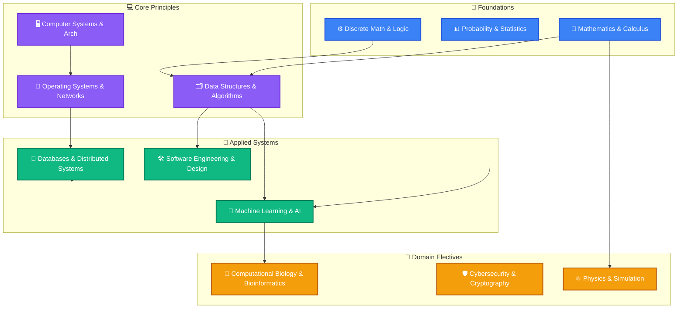
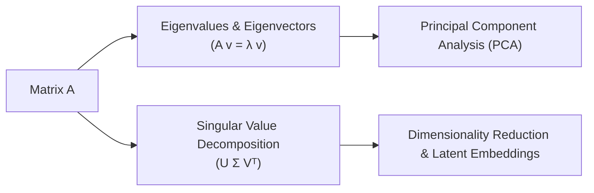
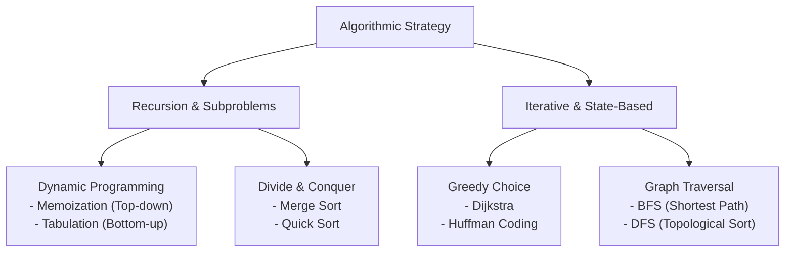
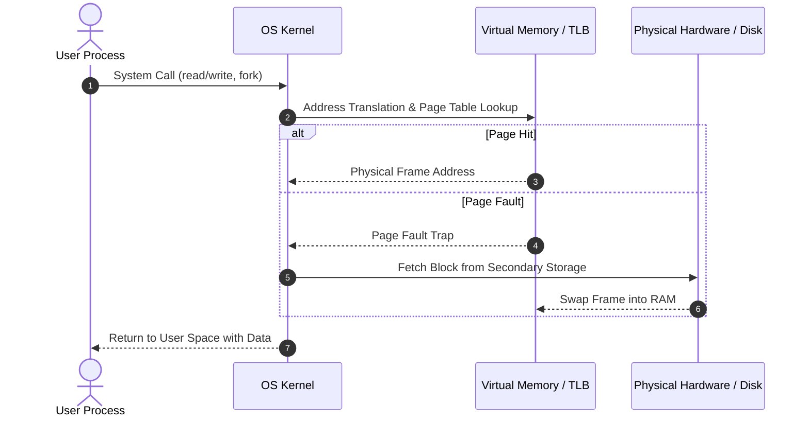
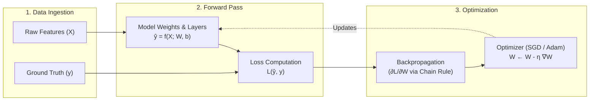
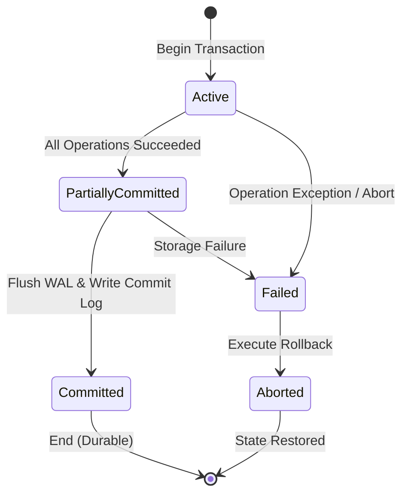

# 📚 Course Notes & Academic Knowledge Base

A comprehensive, centralized repository containing notes, formulas, diagrams, lecture summaries, and reference guides across all academic subjects.

---

## 🗺️ Subject Architecture & Knowledge Map

The diagram below maps how the key disciplines connect across foundational theory, core technical domains, and practical applications.

---

## 📖 Subject Summaries & Visual Overviews

---

### 1. 📐 Mathematics & Linear Algebra
> **Focus**: Vector spaces, matrix transformations, calculus optimization, and eigenvalues.

* **Key Concepts**: Basis & Dimension, Matrix Decompositions (LU, QR, SVD), Multivariable Calculus, Gradient Descent.
* **Core Application**: Foundation for Machine Learning loss functions and graphics pipelines.

---

### 2. 🗂️ Data Structures & Algorithms (DSA)
> **Focus**: Efficiency, asymptotic complexity, foundational memory structures, and algorithmic paradigms.

* **Key Concepts**: Trees, Graphs, Hash Tables, Heaps, Dynamic Programming, Divide-and-Conquer, Greedy Algorithms.

#### 📊 Complexity Reference Matrix
| Structure / Algorithm | Access | Search | Insertion | Deletion | Space |
| :--- | :--- | :--- | :--- | :--- | :--- |
| **Array** | $O(1)$ | $O(n)$ | $O(n)$ | $O(n)$ | $O(n)$ |
| **Hash Table** | N/A | $O(1)$ avg | $O(1)$ avg | $O(1)$ avg | $O(n)$ |
| **Binary Search Tree (Balanced)** | $O(\log n)$ | $O(\log n)$ | $O(\log n)$ | $O(\log n)$ | $O(n)$ |
| **Quick / Merge Sort** | — | — | — | — | $O(n \log n)$ |

---

### 3. 🖥️ Computer Systems & Operating Systems
> **Focus**: Memory hierarchies, virtualization, concurrency, kernel primitives, and I/O.

* **Core Topics**: Processes vs. Threads, Race Conditions & Mutexes, Deadlock Avoidance, Virtual Memory & Paging, File Systems.

---

### 4. 🤖 Machine Learning & Artificial Intelligence
> **Focus**: Predictive modeling, representation learning, loss optimization, and neural architectures.

---

### 5. 💾 Databases & Distributed Systems
> **Focus**: ACID transactions, relational normal forms, distributed consensus, and replication models.

* **Relational vs. Distributed**:
  * **ACID**: Atomicity, Consistency, Isolation, Durability (RDBMS / OLTP).
  * **CAP Theorem**: Consistency, Availability, Partition Tolerance (Distributed systems must choose two under network partition).

---

## 🗂️ Workspace Directory Organization